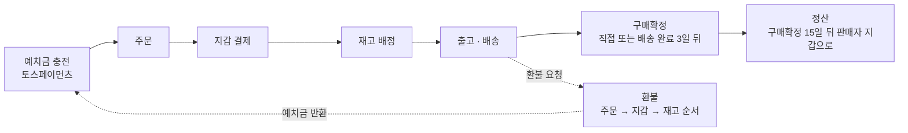
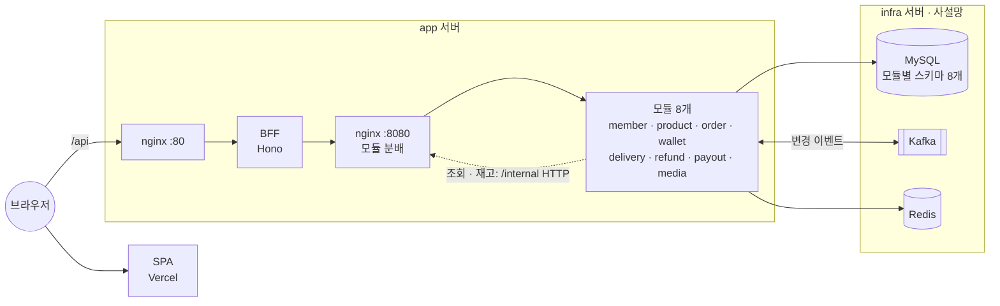

<div align="center">


# 팔도곳간 (paldo-gotgan)

**지역 농산물 판매자와 구매자를 잇는 직거래 커머스**

구매자는 예치금으로 사고, 판매자는 구매확정 15일 뒤 정산받습니다.<br>
같은 요청이 여러 번 와도 돈과 재고는 한 번만 움직이도록 만들었습니다.

[](https://github.com/prgrms-be-adv-devcourse/beadv8_1_200OK_BE/actions/workflows/docker-image.yml)     

[빠른 시작](#-빠른-시작) · [아키텍처](#-아키텍처) · [우리가 푼 문제](#-우리가-푼-문제) · [개발 가이드](docs/DEVELOPMENT.md) · [프론트엔드 저장소](https://github.com/prgrms-be-adv-devcourse/beadv8_1_200OK_FE)

</div>

## 👥 팀 200Ok

프로그래머스 백엔드 단기심화 8기 1팀입니다.

| GitHub | 맡은 일 |
|---|---|
| [@hyc7575](https://github.com/hyc7575) | 상품 · 재고 · 검색 · 리뷰 분석 |
| [@hyunjeong222](https://github.com/hyunjeong222) | 지갑(예치금 · 충전) |
| [@KimSungJun-01](https://github.com/KimSungJun-01) | 주문 · 장바구니 |
| [@leejk0924](https://github.com/leejk0924) | 배송, 인프라 · 배포, 공통 |
| [@monsterant](https://github.com/monsterant) | 정산 · 환불 |
| [@samdonggg](https://github.com/samdonggg) | 회원 · 인증 · 판매자 |

## 📚 목차

- [주요 기능](#-주요-기능)
- [돈이 한 바퀴 도는 흐름](#-돈이-한-바퀴-도는-흐름)
- [아키텍처](#-아키텍처)
- [기술 스택](#-기술-스택)
- [빠른 시작](#-빠른-시작)
- [우리가 푼 문제](#-우리가-푼-문제)
- [협업 방식](#-협업-방식)
- [CI/CD와 배포](#-cicd와-배포)
- [알고 있는 한계](#-알고-있는-한계)
- [문서](#-문서)

## ✨ 주요 기능

| 구매자 | 판매자 | 관리자 | 플랫폼 |
|---|---|---|---|
| 회원 가입 · 로그인, 비밀번호 변경 | 입점 신청과 상점 프로필 관리 | 입점 신청 심사(승인 · 반려) | JWT(RS256) 인증과 JWKS 공개키 배포 |
| 상품 검색과 오타 제안, 카테고리 · 산지 필터 | 상품 · 옵션 · 재고 등록, 판매 상태 · 공개 여부 변경 | 도서산간 우편번호 관리 | 모듈별 DB 스키마 분리 |
| 장바구니와 주문 | 송장 등록과 출고, 배송지 변경 요청 처리 | 정산 실행 · 수동 조정, 대사 확인 | Kafka와 outbox로 모듈 간 이벤트 전달 |
| 예치금 충전(토스페이먼츠) · 결제, 거래 내역 | 환불 요청 승인 | 정산이 막힌 주문 해결 | 가짜 택배사(carrier-simulator)로 배송 상태 전달 |
| 배송 조회, 기본 배송지, 배송지 변경 요청 | 판매자 지갑과 정산 내역 | 멈춘 충전 건 처리 | 이미지 업로드(S3) |
| 구매확정, 환불 요청 · 철회 | 리뷰 감성 · 키워드 분석 | 0건 검색어 · 태그 없는 상품 확인 | 모든 흐름에 traceId 부여 |
| 리뷰 작성과 리뷰 키워드, 관심상품(찜), 상점 보기 | | | ArchUnit으로 모듈 경계 검사 |

## 💸 돈이 한 바퀴 도는 흐름



## 🧱 아키텍처



- 도메인마다 Gradle 서브프로젝트(모듈)가 있고, 모듈은 자기 MySQL 스키마(`paldogotgan_<모듈>`)만 씁니다.
- 배포 서버에서는 모듈 8개를 각자 컨테이너로 띄웁니다([`deploy/app/`](deploy/app)). 로컬에서는 모든 모듈을 한 프로세스로 묶은 `monolith`로도 실행합니다.
- 모듈끼리는 서로의 코드를 직접 참조하지 않습니다. 의존 방향은 도메인 모듈 → `common` 하나이고, 도메인 모듈끼리는 `project(...)` 의존을 걸지 않습니다. 자세한 규칙은 [`docs/CONVENTION.md`](docs/CONVENTION.md)에 있습니다.
- nginx 하나가 바깥용(80, BFF로 전달)과 내부용(8080, 모듈 분배) 포트를 함께 엽니다. `/internal/**`은 내부용 포트에서 같은 서버 안의 호출만 받습니다.
- 조회는 HTTP(`/internal/**`)로, 상태 변경은 Kafka 이벤트로 주고받습니다. 재고 배정 · 해제만 예외로 HTTP입니다.
- `delivery`, `wallet`, `member`, `order`, `product`, `refund`, `payout`은 헥사고날 구조이고, 각 모듈의 `ArchitectureTest`가 구조 규칙을 검사합니다.

| 모듈 | 책임 | 단독 실행 포트 |
|---|---|---|
| `member` | 회원 가입 · 로그인, 판매자 승인, 관심상품, JWKS | 8082 |
| `product` | 상품 · 옵션 · 재고, 검색, 리뷰와 리뷰 분석 | 8085 |
| `order` | 장바구니, 주문, 결제 요청 · 만료, 구매확정 | 8084 |
| `wallet` | 구매자 예치금, 토스 충전, 결제 · 환불 반환, 판매자 지갑 | 8083 |
| `delivery` | 배송비 견적, 출고, 배송 추적, 배송지 | 8086 |
| `refund` | 환불 요청 · 승인, 주문 · 지갑 · 재고를 잇는 환불 진행 | 8088 |
| `payout` | 정산 배치(Spring Batch), 금액 대사, 막힌 주문 처리 | 8087 |
| `media` | 이미지 업로드(S3) | 8081 |
| `common` | 보안 · JWT 검증, 예외 응답, Flyway 도우미, 모듈 간 이벤트 | — |
| `monolith` | 모든 모듈을 묶은 통합 앱 | 8080 |
| `build-logic` | 모든 모듈이 쓰는 빌드 설정(컨벤션 플러그인) | — |

### 설계 원칙

| 원칙 | 내용 | 기록 |
|---|---|---|
| 결제 결과는 돈을 움직인 쪽이 낸다 | 주문은 30분 뒤 혼자 취소하지 않고 지갑에 만료를 요청만 합니다. 지갑이 처음 보는 주문이면 만료로 기록하고 결론을 돌려줍니다 | [ADR order/656](docs/decisions/order/656-payment-expire-request.md), [ADR wallet/693](docs/decisions/wallet/693-wallet-order-payment-expire.md) |
| 환불은 거절될 수 있는 단계부터 | 주문 → 지갑 → 재고 순서로 진행하고, 보내기 전에 진행 표에 먼저 기록합니다 | [ADR refund/543](docs/decisions/refund/543-approval-order-first.md), [ADR refund/574](docs/decisions/refund/574-refund-step-table.md) |
| 정산은 틀린 돈을 고치지 않고 멈춘다 | 금액이 맞지 않는 주문만 빼고 나머지는 지급합니다. 세 번 다시 검사한 뒤 사람에게 넘깁니다 | [ADR payout/391](docs/decisions/payout/391-payout-failure-diagnosis.md), [ADR payout/549](docs/decisions/payout/549-payout-failure-retry-limit.md) |

## 🧰 기술 스택

| 분류 | 기술 |
|---|---|
| **백엔드** |         |
| **데이터** |     |
| **메시징** | -231F20?logo=apachekafka&logoColor=white)  |
| **외부 연동** |  -555555) |
| **인프라** |      |
| **모니터링** |   |
| **테스트** |     |
| **협업** |    |

버전과 설정의 자세한 내용은 [`docs/DEVELOPMENT.md`](docs/DEVELOPMENT.md)의 기술 스택 절에 있습니다.

## 🚀 빠른 시작

명령은 모두 저장소 루트에서 실행합니다.

### 사전 준비

- JDK 25, Docker(Compose 2.20 이상). Docker는 로컬 MySQL · Redis · Kafka와 통합 테스트에 필요합니다.
- 환경변수 파일: `cp .env.example .env`. 기본값으로 실행됩니다. 값의 의미는 [개발 가이드의 환경변수 표](docs/DEVELOPMENT.md#환경변수-env)를 봅니다.
- JWT 서명 키: 아래 명령으로 `keys/`에 키 쌍을 만듭니다(`.gitignore`에 들어 있음). 자세한 내용은 [개발 가이드의 키 관리와 교체](docs/DEVELOPMENT.md#키-관리와-교체)를 봅니다.
  ```bash
  mkdir -p keys
  openssl genpkey -algorithm RSA -pkeyopt rsa_keygen_bits:2048 -out keys/rs256-v1-private.pem
  openssl pkey -in keys/rs256-v1-private.pem -pubout -out keys/rs256-v1-public.pem
  ```
- 외부 서비스 키: `.env.example`의 `TOSS_SECRET_KEY`, `AWS_ACCESS_KEY_ID`, `AWS_SECRET_ACCESS_KEY`, `S3_BUCKET`은 자리표시 값입니다. 앱은 이 값으로도 뜨지만, 토스페이먼츠 충전(wallet)과 이미지 업로드(media, S3)는 실제 키로 바꿔야 동작합니다.

> [!IMPORTANT]
> `.env`, `keys/`, 토스 · AWS 키는 커밋하지 않습니다.

### 1. 로컬 인프라

```bash
docker compose up -d     # MySQL · Redis · Kafka를 1대씩 띄웁니다
```

- MySQL 데이터는 `data/mysql`에 저장되고, 호스트 포트는 `.env`의 `MYSQL_PORT`(기본 3306)입니다.
- 데이터 디렉터리가 빈 채로 처음 뜰 때 `deploy/initdb`가 모듈별 스키마 8개를 만들고 앱 계정(`myuser`)에 권한을 줍니다. 테이블은 앱이 뜰 때 Flyway가 만듭니다.
- 모니터링, Kafka 3대 · Redis 6대 클러스터 같은 상황별 실행은 [개발 가이드의 로컬 실행](docs/DEVELOPMENT.md#3-로컬-실행)을 봅니다.

### 2. 통합 앱

```bash
./gradlew :monolith:bootRun
```

- 포트 8080, 기본 프로파일 `dev`입니다.
- 헬스 체크는 `http://localhost:18080/actuator/health`입니다. 관리 포트 18080은 `MANAGEMENT_SERVER_PORT`로 바꿉니다.
- Swagger UI는 `http://localhost:8080/swagger-ui/index.html`입니다(dev에서만 열림).
- `MYSQL_PORT`를 바꿨다면 `DB_URL`도 같이 지정합니다([개발 가이드](docs/DEVELOPMENT.md#환경변수-env) 참고).

### 3. 모듈 하나만 단독 실행

```bash
./gradlew :wallet:bootRun                              # wallet만 실행 (포트 8083, 접속 DB는 paldogotgan_wallet)
docker compose -f wallet/compose.yml up -d --build     # 또는 컨테이너로 실행
```

- 모듈 이름 프로파일이 자동으로 켜지고, 접속 DB · 포트 같은 설정은 모듈의 `src/main/resources/application-<모듈>.yaml`에 있습니다. 모듈별 포트는 [아키텍처의 모듈 표](#-아키텍처)에 있습니다.
- 루트 `.env`와 모듈 `.env`는 앱이 직접 읽습니다. DB 접속은 `DB_HOST`, `DB_PORT`, `DB_USERNAME`, `DB_PASSWORD`로 바꿀 수 있고, `monolith`용 `DB_URL`은 읽지 않습니다.
- 컨테이너로 실행하려면 `keys/`와 `<모듈>/.env`(모듈 DB 계정)가 있어야 합니다. 모듈 계정은 `./infra/mysql/sync-module-users.sh --init`으로 만듭니다.
- 헬스 체크는 `http://localhost:<포트>/actuator/health`입니다.

> [!NOTE]
> 다른 모듈이 같이 떠 있지 않으므로 모듈 간 이벤트 연동(예: 회원 가입 → 장바구니 생성)과 `/internal/**` 호출은 동작하지 않습니다. 이 연동은 모든 모듈을 함께 띄웠을 때만 됩니다.

<details>
<summary>이미 쓰던 로컬 DB가 있는 경우</summary>

모듈별 스키마로 바뀌기 전에 만든 `data/mysql` 볼륨은 그대로 쓸 수 없고, 앱을 띄우면 Flyway 검증에서 멈춥니다. 둘 중 하나로 맞춥니다.

- **방법 A, 데이터 유지**: 앱을 멈추고 `infra/mysql/migration-288/migrate.sh all paldogotgan myuser`로 이전합니다. Flyway 이력이 알려진 55건(전부 성공)인 DB만 이전합니다.
- **방법 B, 초기화**: `docker compose down` 후 `data/mysql`을 지우고 다시 `docker compose up -d`합니다.

명령 전체와 주의점은 [개발 가이드의 로컬 DB를 이전하기](docs/DEVELOPMENT.md#로컬-db를-이전하기)에 있습니다.

</details>

### 빌드와 테스트

```bash
./gradlew build          # 전체 컴파일 · 테스트 · jar (모듈마다 테스트 JVM과 Testcontainers를 띄워 몇 분 걸립니다)
./gradlew :wallet:test   # 모듈 하나의 테스트
./gradlew :wallet:build  # 모듈 하나의 컴파일 · 테스트 · jar
```

- 통합 테스트는 Testcontainers로 MySQL을 띄우므로 Docker가 켜져 있어야 합니다.
- 테스트 종류와 작성 기준은 [`docs/CONVENTION.md`](docs/CONVENTION.md)의 테스트 절을 봅니다.

### 새 모듈 만들기

```bash
./gradlew createModule -PmoduleName=notification -PdisplayName=알림
```

`notification`/`알림`은 예시 값이고, 실제로는 `-PmoduleName=<모듈이름>`(영문 소문자, 이미 있는 이름은 불가)과 `-PdisplayName=<표시이름>`을 씁니다. 모듈 폴더, `build.gradle.kts`, 기본 패키지, 앱 클래스, `ArchitectureTest` 틀을 만들고, 이어서 직접 할 일을 출력합니다.

1. `settings.gradle.kts`의 `include(...)`에 모듈 이름 추가
2. 통합 앱에 함께 올리려면 `monolith/build.gradle.kts`에 `implementation(project(":모듈"))` 추가

스키마를 쓰는 모듈이면 할 일이 더 있습니다. [개발 가이드의 새 모듈 만들기](docs/DEVELOPMENT.md#새-모듈-만들기)를 봅니다.

### Docker 이미지

```bash
docker build .                                  # monolith 이미지 빌드 (약 2분, 빌드 인자 MODULE로 모듈 이미지도 만들 수 있습니다)
docker compose --profile app up -d --build      # DB와 앱을 컨테이너로 함께 실행
```

EC2 배포와 롤백은 [`docs/DEPLOY.md`](docs/DEPLOY.md)를 봅니다.

## 🧩 우리가 푼 문제

> 수치는 모두 로컬 환경에서 잰 값입니다. 측정 조건은 각 PR과 이슈에 있습니다.

<details>
<summary><strong>1. 동시 로그인 10건에 서버 전체가 30초 멈춤</strong></summary>

**문제**

- 동시 로그인 9건은 0.6초에 끝났는데, 10건에서는 90.7초가 걸리고 18건이 500으로 실패했습니다.
- 개발 모니터링 대시보드에서 DB 커넥션 풀 사용률이 100%에 고정된 것을 보고 찾았습니다.

**원인**

- 트랜잭션 없이 실행되던 로그인 메서드가 첫 조회에서 연 커넥션을 끝까지 쥐고 있었습니다.
- 이어지는 저장이 새 트랜잭션을 열면서 커넥션을 하나 더 요구해, 요청 하나가 커넥션 2개를 썼습니다.

**해결**

- 읽기 트랜잭션 → 비밀번호 검사(트랜잭션 밖) → 쓰기 트랜잭션으로 나눠 요청당 커넥션을 1개로 줄였습니다.
- 버그 수정과 튜닝을 섞지 않으려고 풀 크기는 바꾸지 않았습니다.

**결과** (k6, 동시 사용자 10 → 30 → 50명)

| 지표 | 수정 전 | 수정 후 |
|---|---|---|
| 로그인 성공률 | 82.4% | 100% |
| 500 응답 | 93건 | 0건 |
| p95 | 30.1초 | 0.64초 |

자세히: [PR 452](https://github.com/prgrms-be-adv-devcourse/beadv8_1_200OK_BE/pull/452), [ADR member/425](docs/decisions/member/425-login-connection-deadlock.md)

</details>

<details>
<summary><strong>2. 주문 메시지 발송이 DB 커넥션을 붙잡아 주문 API가 멈춤</strong></summary>

**문제**

- 부하테스트에서 초당 주문을 80건으로 올리자 커넥션 10개가 모두 묶이고 1.5~3분 동안 주문이 멈췄습니다.

**원인**

- 주문을 커밋한 직후 메시지 발송 작업을 공용 실행기 대기열에 넣습니다. 대기열이 차면 넣는 쪽이 기다립니다.
- 요청 스레드는 커넥션을 쥔 채 기다리고, 대기열을 비울 발송 스레드는 커넥션을 얻지 못했습니다.

**해결**

- 주문 전용 실행기를 두고, 대기열이 차면 기다리지 않고 거절합니다.
- 거절된 메시지는 outbox에 PENDING으로 남아 30초마다 도는 재발송이 보냅니다.
- 같은 방식을 배송 outbox에도 적용했습니다([ADR delivery/793](docs/decisions/delivery/793-outbox-send-drop-when-full.md)).

**결과** (같은 k6 시나리오)

- 30초 넘게 커넥션을 기다린 요청: 262건 → 0건
- 주문 성공: 3,918건 → 5,768건
- 이 측정에서 남은 실패는 원인이 달라 따로 고쳤습니다.

자세히: [이슈 715](https://github.com/prgrms-be-adv-devcourse/beadv8_1_200OK_BE/issues/715), [PR 716](https://github.com/prgrms-be-adv-devcourse/beadv8_1_200OK_BE/pull/716)

</details>

<details>
<summary><strong>3. 같은 결제 이벤트가 동시에 오면 일부가 '처리 안 됨'으로 남음</strong></summary>

**문제**

- 같은 주문의 결제 이벤트 20건을 동시에 보내는 실험(3회)에서 7건이 '처리 안 됨'으로 남았습니다. 차감은 한 번만 됐습니다.

**원인**

- "이미 처리했나"를 조회로 판단했습니다. 잠금 전 스냅샷에는 먼저 끝난 결제가 보이지 않았습니다.
- 리스너 트랜잭션에 합류해 격리 수준 설정이 조용히 무시되고 있었습니다.

**해결**

- 조회 대신 처리 기록을 먼저 넣습니다(`INSERT IGNORE`). 0건이 들어가면 이미 처리된 것이므로 처음 결과를 그대로 돌려줍니다.
- 판단을 DB 유니크 제약에 맡겼습니다.

**결과**

- 처리 안 됨: 7건 → 0건
- 지갑 처리 시간: 12.3ms → 12.6ms로 거의 그대로

자세히: [이슈 360](https://github.com/prgrms-be-adv-devcourse/beadv8_1_200OK_BE/issues/360), [PR 362](https://github.com/prgrms-be-adv-devcourse/beadv8_1_200OK_BE/pull/362)

</details>

<details>
<summary><strong>4. 재고 해제가 배정보다 먼저 끝나면 재고가 영구히 잠김</strong></summary>

**문제**

- 주문은 재고 배정을 3초 기다리다 포기하고 해제를 보냅니다.
- 해제가 먼저 끝나면 "풀 것이 없음"으로 성공하고, 그 뒤 배정이 커밋됩니다.
- 취소된 주문이 재고를 영원히 잡고, 에러 로그도 남지 않았습니다.

**해결**

- 배정과 해제 모두 트랜잭션의 첫 SQL로 주문 헤더 행을 upsert합니다. 같은 주문의 요청은 한 줄로 섭니다.
- 해제는 배정 기록이 없어도 헤더를 `RELEASED`로 남깁니다. 늦게 온 배정은 이 기록을 보고 409로 거절됩니다.
- 버린 대안: 시간 초과 늘리기와 잠금만 걸기는 순서 역전을 막지 못했습니다. Kafka 순서 보장과 정리 배치도 검토했습니다.

**결과**

- 동시성 시험 3개를 5번씩 돌려 15/15 통과, 데드락 0번
- 이미 샌 재고 건수는 재지 않았고, 찾는 쿼리만 있습니다.

자세히: [PR 605](https://github.com/prgrms-be-adv-devcourse/beadv8_1_200OK_BE/pull/605), [ADR product/531](docs/decisions/product/531-allocation-header-lock.md)

</details>

<details>
<summary><strong>5. 같은 묶음 환불을 동시에 승인하면 배송비가 사라지거나 두 번 빠짐</strong></summary>

**문제**

- 판매자가 같은 배송 묶음의 환불 두 건을 동시에 승인하면 배송비 계산이 어긋났습니다.

**원인**

- 잠금만 걸면 기다리게는 하지만, 기다린 뒤에도 트랜잭션 시작 시점의 옛 값을 읽었습니다.

**해결**

- 묶음 잠금에 더해 승인 트랜잭션만 `READ COMMITTED`로 실행해, 기다린 뒤 최신 값을 보게 했습니다.
- 승인 뒤 순서도 지갑 → 주문에서 주문 → 지갑 → 재고로 바꿨습니다. 출고돼 거절될 수 있는 주문을 먼저 확인해, 거절되면 아무것도 움직이지 않습니다.

**결과** (동시 승인 테스트 10회)

| 방식 | 통과 |
|---|---|
| 변경 전 | 0/10 |
| 잠금만 | 0/10 |
| 잠금 + READ COMMITTED | 10/10 |

자세히: [PR 451](https://github.com/prgrms-be-adv-devcourse/beadv8_1_200OK_BE/pull/451), [ADR refund/543](docs/decisions/refund/543-approval-order-first.md)

</details>

<details>
<summary><strong>6. 판매자 10만 명이면 정산 배치가 3시간 넘게 걸림</strong></summary>

**문제**

- 판매자를 1만 명에서 10만 명으로 늘리자 정산 초안(draft) 단계가 33.5배 느려졌고, 배치 전체가 3시간 11분 걸렸습니다.

**원인**

- "다음 판매자 100명" 조회가 매번 남은 후보 전체를 묶고 정렬했습니다. 10만 명에서 1,001번 실행해 45억 줄을 읽었습니다.

**해결**

- 스냅샷에 판매자 ID와 인덱스를 두고, "지난번 마지막 판매자 다음 번호부터" 고르는 커서 방식으로 바꿨습니다.
- 대신 처리 순서가 "먼저 판 순"에서 "판매자 번호 순"으로 바뀌는 것을 받아들였습니다.

**결과** (판매자 10만 명)

| 지표 | 수정 전 | 수정 후 |
|---|---|---|
| 판매자 고르기 | 5,317초 | 9.65초 |
| 초안(draft) 단계 | 7,342초 | 2,175초 (−70%) |
| 배치 전체 | 11,459초 | 6,574초 (−43%) |

남은 병목은 [이슈 304](https://github.com/prgrms-be-adv-devcourse/beadv8_1_200OK_BE/issues/304)에서 이어서 봅니다.

자세히: [PR 763](https://github.com/prgrms-be-adv-devcourse/beadv8_1_200OK_BE/pull/763), [ADR payout/304](docs/decisions/payout/304-payout-draft-seller-cursor.md)

</details>

## 🤝 협업 방식

- **브랜치:** `dev`에서 `<유형>/<이슈번호>` 브랜치를 만들고 PR로 `dev`에 합칩니다. `main`은 배포하는 코드입니다. `main`과 `dev`에는 직접 커밋하지 않습니다.
- **커밋:** `<Type>: <제목>` 형식에 `Ref: #이슈번호` 꼬리말을 씁니다. 규칙은 [`docs/CONVENTION.md`](docs/CONVENTION.md)에 있습니다.
- **설계 결정 기록:** 결정과 버린 대안을 [`docs/decisions/`](docs/decisions)에 모듈별 ADR로 남기고 PR에서 링크합니다.
- **구조 규칙 강제:** 패키지 · 모듈 규칙을 ArchUnit 테스트로 만들어, 사람이 쓰든 AI가 쓰든 규칙을 어기면 테스트가 깨집니다.
- **AI 협업:** 팀 규칙을 `.claude/rules/`와 프로젝트 스킬(`.claude/skills/`)에 두어 Claude Code도 같은 규칙으로 작업합니다. PR마다 Claude 리뷰 봇이 먼저 보고 사람이 리뷰합니다.

| 숫자로 보기 | |
|---|---|
| 도메인 모듈 | 8개 |
| 설계 결정 기록(ADR) | 86건 |
| ArchUnit 구조 규칙(`@ArchTest`) | 240개 |
| Flyway 마이그레이션 | 121개 |
| 머지된 PR | 337개 |

## 🔄 CI/CD와 배포

| 워크플로 | 하는 일 |
|---|---|
| `docker-image` | `main`에 push되면 `monolith`와 모듈 8개의 이미지를 빌드해 GHCR에 올립니다 |
| `claude-code-review` | PR이 열리거나 바뀔 때 Claude가 코드를 리뷰합니다 |
| `pr-review-request-slack` | PR 리뷰 요청을 Slack으로 알립니다 |

- AWS 인프라(VPC, EC2 app · infra 서버, S3)는 Terraform으로 관리합니다([`docs/INFRA.md`](docs/INFRA.md)).
- app 서버는 모듈 8개와 nginx · BFF를, 사설망의 infra 서버는 MySQL · Kafka · Redis를 컨테이너로 띄웁니다.
- 배포와 롤백 절차는 [`docs/DEPLOY.md`](docs/DEPLOY.md)에 있습니다.

## 🔭 알고 있는 한계

<details>
<summary>지금 알고 있는 한계</summary>

| 한계 | 지금 상태 |
|---|---|
| CI에서 테스트를 돌리지 않음 | 워크플로는 이미지 빌드(`-x test`), 리뷰 봇, 알림 3개입니다. 테스트와 ArchUnit 규칙은 각자 로컬에서 돌립니다 |
| 부하 측정은 모두 로컬 한 대 | 배포 서버 사양에서 다시 잰 값은 없습니다 |
| 이미 샌 재고 건수는 재지 않음 | 찾는 쿼리만 있습니다([ADR product/531](docs/decisions/product/531-allocation-header-lock.md)) |
| 정산 관리자 조정 일부는 금액 검사 밖 | 화면에 표시만 하고 서버에서 막지 않습니다 |
| 정산 배치의 남은 병목 | 발행 단계 시간 증가 원인을 찾는 중입니다([이슈 304](https://github.com/prgrms-be-adv-devcourse/beadv8_1_200OK_BE/issues/304)) |

</details>

## 📄 문서

| 문서 | 내용 |
|---|---|
| [`docs/DEVELOPMENT.md`](docs/DEVELOPMENT.md) | 기술 스택, 로컬 실행, 설정과 환경변수, 모듈별 스키마, 모듈 구조(헥사고날 포함), 예외 처리, 인증 |
| [`docs/CONVENTION.md`](docs/CONVENTION.md) | 이름, 패키지 구조, 패키지별 코드, 테스트, Git 규칙 |
| [`docs/DEPLOY.md`](docs/DEPLOY.md) | EC2 컨테이너 배포, 롤백, 모듈별 스키마 이전 |
| [`docs/INFRA.md`](docs/INFRA.md) | AWS 인프라(Terraform) |
| [`docs/decisions/`](docs/decisions) | 설계 결정 기록(ADR)과 작성 규칙 |
| [`GLOSSARY.md`](GLOSSARY.md) | 모듈을 가로질러 같은 뜻으로 쓰는 용어 |

<p align="center"><sub>팔도곳간 · 팀 200Ok</sub></p>
