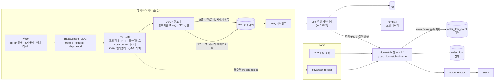
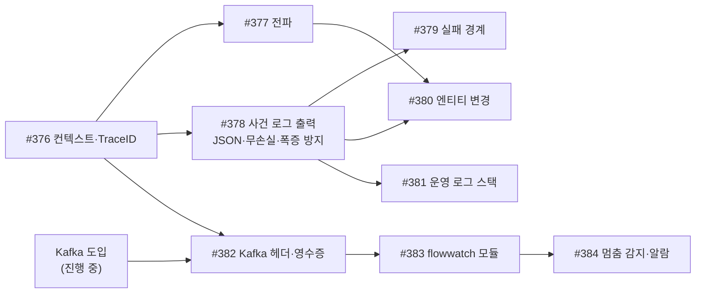

# 주문 흐름 추적·장애 감지 로깅 시스템 설계

- 에픽: #375
- 하위 이슈: #376 ~ #384
- 관련 이슈: #374 (개발 모니터링)
- 결정 이유와 버린 대안: [`docs/decisions/common/375-order-flow-tracking.md`](../decisions/common/375-order-flow-tracking.md)
- 기준일: 2026-11-05, 개정 2026-11-08(성공 사건 전부 저장, flowwatch 별도 서버, 사건 수집 경로). 구현하면서 바뀐 내용은 이 문서도 같이 고친다. 코드와 이 문서가 다르면 코드가 기준이다.

이 문서는 시스템 전체가 **무엇을, 어떻게** 하는지를 한곳에 모은다. **왜** 그렇게 정했는지는 위의 ADR에 있다.

## 1. 목적

> 분산 환경에서 코드의 직접 변경을 최소화하여 데이터의 흐름을 파악하고, 성공과 실패를 모두 빠짐없이 저장하여 흐름이 비거나 멈췄을 때 빠르게 파악하고 대응하는 시스템이다.

이 정의에서 나온 설계 원칙은 여섯 가지다.

| 원칙 | 의미 |
|---|---|
| 코드 변경 최소화 | 모듈 개발자는 추적 어노테이션만 붙인다. 나머지는 경계 지점에서 자동으로 수집한다 |
| 성공·실패 모두 저장 | 흐름 사건은 성공이든 실패든 동기로 쓰고 버리지 않는다. 버려도 되는 것은 일반 로그뿐이다. 성공 기록이 비었을 때 누락인지 장애인지 읽으려면 기록이 유실되면 안 된다 |
| 비즈니스 무영향 | 로그 스택이나 flowwatch 모듈이 멈춰도 주문 처리는 계속된다 |
| 상태의 진실 원천은 엔티티 | 이력은 append-only 기록이다. 이력만 보고 주문 상태를 확정하지 않는다. 기록이 샜을 수 있기 때문이다 |
| 하나의 키로 묶기 | 진입점이 달라도 orderId(+shipmentId)로 한 주문의 흐름을 모두 조회한다 |
| 빈칸은 장애가 아니다 | 중간 단계가 비어도 지나온 것으로 본다. 데이터 누락 가능성을 항상 열어 둔다. 끝에서 멈춘 것은 "멈춤 의심"이며 알리기 전에 엔티티 상태로 다시 확인한다 |

## 2. 범위

**포함**
- 주문 생성부터 정산까지 한 주문의 흐름을 기록하고 조회한다.
- 실패(비즈니스 실패, 시스템 예외, 외부 호출 실패)를 기록한다.
- 성공 사건을 빠짐없이 이력으로 저장하고 orderId로 시간순 조회한다.
- 다음 단계가 오지 않아 멈춘 주문을 감지하고 알린다.

**범위 밖**
- 고객·CS용 배송 조회 화면
- 배송사 실제 연동 구현. 계약 기준 설계만 남긴다(§10)
- Kafka 도입 자체(진행 중). 이 문서는 도입된 구간을 구독하는 쪽만 다룬다
- 누락 단계를 채워 넣는 보정과, 채운 단계를 '추정'으로 구분해 표시하는 기능(후속 기능). 보정이 어려운 경우(판매자별 복수 배송 분기, 취소·환불, 순서 뒤바뀜)는 관리자가 직접 관리한다
- bulk·native 쿼리 기록(`@Modifying` Aspect). 추후 고려한다
- 운영 서버 지표(Prometheus) 수집. 맡는 이슈가 아직 없다. 개발 환경 지표는 #374에서 다룬다

## 3. 대상 흐름

한 주문은 아래 단계를 거친다. 진입점이 HTTP, 스케줄러, 배치, 외부 콜백으로 서로 달라서 traceId는 중간에 바뀔 수 있다. 흐름을 묶는 키는 orderId다.

| 단계(step) | 모듈 | 진입점 | 다음 단계까지 기준 시간 |
|---|---|---|---|
| 주문 생성 (결제 대기) | order | HTTP | 결제까지 5분 |
| 지갑 결제 (잔액 확인·차감) | wallet | 이벤트 | 주문 결제 반영까지 5분 |
| 재고 할당 | product | 내부 HTTP | (주문 생성과 같은 요청) |
| 배송비 조회 | delivery | 내부 HTTP | (주문 생성과 같은 요청) |
| 주문 결제 완료 | order | 이벤트 | 배송 생성 영수증까지 5분 |
| 배송 생성 (준비 중) | delivery | 이벤트 | 발송까지 3일 |
| 발송 (배송 중) | delivery | HTTP(판매자) | 배송 완료까지 2일 |
| 배송 완료 | delivery | 외부 배송사 콜백 | 구매 확정까지 3일 1시간 |
| 구매 확정 | order | HTTP(구매자) / `PurchaseConfirmScheduler` | 정산 영수증까지 5분 |
| 정산 | payout | Spring Batch (`PayoutJobScheduler`) | 끝 |

- 한 주문에 판매자별로 배송이 여러 건 생기므로, 배송 단계부터는 shipmentId로도 구분한다.
- 배송 중에는 배송사가 상태를 1~2일 동안 서로 다른 시각에 여러 번 보낸다. 같은 단계의 사건이 여러 건일 수 있고, 응답이 늦어 앞 단계와 바로 이어지지 않을 수 있다.
- 기준 시간은 flowwatch의 흐름 정의 yaml에서 바꾼다(§8.3).

## 4. 전체 구조



경로는 두 개다.
- **기록 경로**: 각 서비스가 사건 로그를 로컬 파일에 남기면 Alloy가 Loki로 모은다. Grafana에서 조회와 디버깅에 쓴다. 1단계(#376~#381)에서 만든다.
- **이력·감지 경로**: flowwatch가 두 곳에서 흐름 사건을 가져온다. Kafka를 쓰는 구간은 토픽을 구독하고, 쓰지 않는 구간은 Loki를 조회한다. 자기 DB에 이력으로 쌓고 멈춘 주문을 찾는다. Kafka 구간은 도입이 끝나는 대로 붙인다.

배포 구조: 현재 운영 배포 단위는 monolith이고 모듈별 서버로 바꾸는 중이다. 이 설계는 분산된 서버를 전제로 한다. 서버가 둘 이상이 되기 전에 Snowflake 노드 ID 할당과 StuckDetector 중복 실행 방지(§10)를 끝내야 한다.

## 5. 추적 컨텍스트 (#376, #377)

### 5.1 키

| 키 | 발급과 출처 | 용도 |
|---|---|---|
| `traceId` | Snowflake. 진입점마다 새로 발급하거나 헤더에서 이어받는다 | 한 요청이나 한 번의 실행 안의 로그를 잇는다 |
| `orderId` | 주문 생성 시점에 bind하거나 헤더, `@TraceKey`에서 얻는다 | 주문 흐름 전체를 묶는다 (**주 키**) |
| `shipmentId` | 배송 생성 이후 | 판매자별 배송을 구분한다 |
| `module` | 실행 중인 모듈 | 필터 |
| `step` | 흐름 단계 | 흐름 위치 |
| `eventType` | 수집 지점 | 로그 종류 (§6.2) |

### 5.2 발급 지점

| 진입점 | 동작 |
|---|---|
| HTTP | `TraceFilter`: 서버끼리 부르는 `/internal/` 요청(loopback에서 온 것)은 `X-Trace-Id`를 이어받고, 그 밖의 요청은 항상 새로 만든다. 응답 헤더로 돌려준다 |
| `@Scheduled` | 실행할 때마다 새 traceId를 발급한다 |
| Spring Batch | `JobExecutionListener`로 실행 단위마다 새 traceId를 발급한다 |
| Kafka 소비 | 메시지 헤더에서 복원한다 (#382) |
| 외부 콜백 | 새로 발급한다. orderId는 송장 번호로 Shipment를 찾아서 bind한다 |

Snowflake 노드 ID는 `trace.node-id` 설정으로 정한다. 지금은 인스턴스가 하나라고 가정한다.

구현(#376, `com.ok.common.trace`)은 다음과 같다.
- **traceId**: 41비트 시각(기준 2026-01-01T00:00:00Z) + 10비트 노드 ID + 12비트 시퀀스. 시각은 공용 `Clock` 빈에서 읽는다. 값에서 발급 시각을 역산할 수 있다 (`docs/DEVELOPMENT.md` 12절).
- **HTTP**: `TraceFilter`가 Spring Security 필터보다 앞(order -200)에 있어 401·403 응답에도 `X-Trace-Id` 헤더가 실린다. 요청 헤더는 `/internal/`이면서 loopback에서 온 요청에서만, 그중에서도 0으로 시작하지 않는 숫자 15~18자리일 때만 이어받고, 아니면 무시하고 새로 발급한다. 외부 호출자가 이전 요청의 traceId를 보내 `eventKey`(traceId가 구분자)와 겹치게 만드는 것을 막기 위해서다.
- **`@Scheduled`**: Boot가 만드는 `ObservationRegistry`에 `ObservationHandler`를 등록해, 작업을 실행하는 스레드에서 범위가 열릴 때 새 traceId를 넣고 닫힐 때 이전 MDC로 되돌린다.
- **Spring Batch**: `BeanPostProcessor`가 모든 `AbstractJob`에 `JobExecutionListener`를 붙인다. Batch가 클래스패스에 없는 앱(order 등)에서는 등록되지 않는다.
- 이 이슈에서 만든 것은 발급과 MDC 설정까지다. `module` 값 채우기, `HTTP_IN` 로그는 만들지 않았다.

### 5.3 전파

| 경계 | 방식 | 이슈 |
|---|---|---|
| Modulith 비동기 리스너 | 기존 `MdcTaskDecorator`가 모든 비동기 실행기에서 MDC를 복사한다 (Kafka로 옮기기 전까지). 같은 일을 하는 `TraceTaskDecorator`를 따로 만들지 않았다 | #377 |
| 내부 HTTP (`InternalRestClient`) | `TraceHeaderInterceptor`가 MDC에 값이 있는 `X-Trace-Id`, `X-Order-Id`, `X-Shipment-Id`만 헤더로 보내고, `TraceFilter`가 `/internal/` 경로에서 복원한다 | #377 |
| Kafka | producer 인터셉터가 헤더를 넣고 consumer가 복원한다 | #382 |

내부 HTTP 헤더가 빠지면 받는 쪽의 bulk 쿼리(재고 할당)가 어느 주문인지 알 수 없다.

구현(#377)은 다음과 같다.
- **비동기 리스너**: `AsyncConfig`가 모든 실행기에 `MdcTaskDecorator`를 적용한다. 리스너를 띄우는 스레드의 MDC 전체(traceId, orderId 등)를 그대로 복사하고, 끝나면 실행 스레드의 MDC로 되돌린다.
- **보내는 쪽**: `TraceHeaderInterceptor`를 주문·환불의 `InternalRestClient`와 상품의 주문 조회 클라이언트(`OrderApiClient`)에 한 줄씩 붙였다. 모듈의 호출 코드는 바꾸지 않는다.
- **받는 쪽**: 별도 필터를 두지 않고 `TraceFilter`가 복원한다. `X-Trace-Id`, `X-Order-Id`, `X-Shipment-Id`는 모두 `/internal/` 경로이면서 loopback 주소에서 온 요청에서만 이어받는다(Security의 `/internal/**` 조건과 같다. 필터가 Security보다 앞이라 막힐 요청의 헤더도 먼저 읽기 때문이다). 공개 API에서 받으면 호출자가 임의의 주문 번호로 로그를 오염시킬 수 있기 때문이다. 형식(0으로 시작하지 않는 숫자 1~18자리)이 틀리면 무시하고, 요청이 끝나면 진입 전 MDC로 되돌린다.
- 이어지지 않는 곳: 미완료 이벤트 재발행(호출 스레드가 없다)과 Kafka(#382)는 전파되지 않는다.

## 6. 수집

### 6.1 수집 지점

| 수집 지점 | 기록 대상 | eventType | 이슈 |
|---|---|---|---|
| HTTP 필터 | 요청과 응답 요약 (흐름 사건으로 볼지는 §11) | `HTTP_IN` | #378 (#376의 `TraceFilter`는 traceId만 다룬다) |
| `RestApiException` 처리 | 잔액 부족, 재고 부족 같은 비즈니스 실패와 에러 코드 | `BUSINESS_FAILURE` | #379 |
| `ApiControllerAdvice` | 처리되지 않은 예외 (1회만) | `SYSTEM_FAILURE` | #379 |
| 비동기 리스너 | 리스너 처리 실패 | `SYSTEM_FAILURE` | #379 |
| HTTP 클라이언트 | 내부·외부 호출 실패, 임계 시간 초과 | `HTTP_CALL` | #379 |
| Hibernate PostCommit 리스너 | `@Tracked` 엔티티의 생성·변경·삭제 (`@TrackedField`만, 변경 전후 값). 커밋 뒤에 사건 로그로 남기므로, 커밋과 기록 사이에 앱이 죽으면 한 건이 샐 수 있다 | `STATE_CHANGED` | #380 |
| `@Modifying` Aspect (추후) | `@Tracked` 엔티티 리포지토리의 bulk·native 쿼리: 메서드명, ID와 숫자 파라미터, 영향받은 행 수. 영향 행이 0이면 실패로 기록 | `STATE_CHANGED` / `BUSINESS_FAILURE` | #380 |
| Kafka producer | 발행 | `MESSAGE_SENT` | #382 |
| Kafka consumer 래퍼 | 수신, 처리 결과 | `MESSAGE_RECEIVED`, `RECEIVED_NO_EFFECT` | #382 |
| DLQ 이동 직전 | 재시도를 모두 소진한 메시지 | `SYSTEM_FAILURE` | #382 |
| StuckDetector | 멈춤, 복구 | `STUCK`, `RECOVERED` | #384 |

Hibernate 리스너를 거치지 않는 bulk·native 쿼리(Aspect로 보완해야 하지만 추후로 미룬다. 그동안 이 단계는 PostCommit으로 잡히지 않는다):
- `BuyerWalletRepository`: 지갑 차감 (native)
- `ProductOptionRepository`, `ProductStockAllocationRepository`: 재고 할당 (JPQL bulk)

### 6.2 로그 스키마 (JSON)

필드 이름은 고정한다. 필드를 추가하는 것은 괜찮지만, 이름을 바꾸거나 지우면 조회와 대시보드가 깨진다.

```json
{
  "timestamp": "2026-11-05T10:15:30.123+09:00",
  "level": "WARN",
  "app": "paldogotgan",
  "module": "wallet",
  "eventType": "BUSINESS_FAILURE",
  "step": "WALLET_PAYMENT",
  "traceId": "111634463317819397",
  "eventKey": "1024:-:WALLET_PAYMENT:FAILURE:INSUFFICIENT_BALANCE:111634463317819397",
  "orderId": 1024,
  "shipmentId": null,
  "outcome": "FAILURE",
  "message": "지갑 잔액이 부족해 결제하지 못했다",
  "error": { "code": "INSUFFICIENT_BALANCE", "type": "RestApiException", "stack": [] },
  "entity": null,
  "changes": null
}
```

- `STATE_CHANGED`일 때는 `entity`(이름과 ID)와 `changes`(`{필드: [이전, 이후]}`)를 채운다.
- `stack`은 깊이 30까지만 남긴다.
- `eventKey`는 같은 사건이 두 번 와도 flowwatch가 한 번만 저장하게 하는 멱등 키다. 구성은 `{orderId[:shipmentId]}:{step}:{outcome[:errorCode]}:{구분자}`다.
  - 시스템 안의 사건: 구분자는 `traceId`다. 재전송은 같은 traceId라 같은 키이고, 다시 시도한 요청은 새 traceId라 다른 키다. Kafka 구간은 헤더로 복원한 traceId를 쓰므로 두 경로가 같은 키를 만든다.
  - 택배사 이벤트: 구분자는 `status.code:time`이다. 택배사 응답의 이벤트에는 ID가 없고 상태 코드가 9개로 거칠어서 시각이 필요하다. 시각이 비면 상태 코드, 설명, 장소의 해시를 쓴다. 송장번호는 사건 구분이 아니라 Shipment를 찾아 연결하는 데만 쓴다.
  - 같은 키가 또 오면 새로 저장하지 않고 무시한다. 같은 요청 안에서 같은 단계가 반복돼도 한 건으로 본다.

### 6.3 추적 대상 표시 (어노테이션)

| 어노테이션 | 위치 | 의미 |
|---|---|---|
| `@Tracked` | 엔티티 | 이 엔티티의 변경을 기록한다 |
| `@NotTracked` | 엔티티 | orderId나 shipmentId가 있지만 기록하지 않는다 (명시적 제외) |
| `@TraceKey` | 필드 | 이 필드 값으로 흐름을 묶는다 (예: `orderId`) |
| `@TrackedField` | 필드 | 변경 값을 기록할 필드 (화이트리스트) |

- 묶는 키를 찾는 순서: `@TraceKey`를 먼저 보고, 없으면 MDC를 본다.
- ArchitectureTest: orderId나 shipmentId 필드가 있는 엔티티에 `@Tracked`도 `@NotTracked`도 없으면 테스트가 실패한다. 모듈 개발자는 이 테스트가 실패했을 때만 로깅 시스템을 알면 된다.
- 첫 적용 대상: Order, OrderItem, Shipment, BuyerWallet, ProductOption, ProductStockAllocation. 각 모듈 담당자가 리뷰한다.

## 7. 출력과 저장

### 7.1 앱 로그 출력 (#378)

출력은 두 종류로 나눈다. **흐름 사건**(§6.1의 eventType)은 성공이든 실패든 버리지 않는다. **일반 로그**에는 아래 폭증 방지 장치를 적용하고 버려도 된다. 구분 방법은 구현 이슈에서 정한다.

| 항목 | 값 |
|---|---|
| 일반 로그 appender | `AsyncAppender`, 큐 8192, `neverBlock` (넘치면 버림) |
| 흐름 사건 appender (성공·실패 모두) | 로컬 파일에 동기로 기록. 부하가 문제가 되면 막히는 큐로 바꿀 수 있다 |
| 일반 로그 중 WARN 이상 | 로컬 파일에 동기로 기록. 흐름 사건의 실패(`BUSINESS_FAILURE` 등)는 이 행이 아니라 흐름 사건 appender로 간다 |
| 크기 상한 | 필드 1KB, 이벤트 8KB, 스택 깊이 30 |
| 같은 에러 억제 | 같은 에러 키가 1분에 N회를 넘으면 "N건 생략" 요약 한 건으로 바꾼다 (TurboFilter). 일반 로그에만 적용하고 흐름 사건에는 적용하지 않는다 |
| 샘플링 | 일반 로그의 HTTP 성공 요약 10%. 흐름 사건에는 적용하지 않는다 |
| 마스킹 | 인코더에서 필드 이름의 키 패턴(name, phone, address, email, receiver*)으로 값을 일괄 마스킹한다. 문장 속 값은 가리지 않는다 |
| 롤링 (일반 로그) | 파일 100MB, 전체 2GB, 7일 |
| 롤링 (흐름 사건) | 일반 로그와 분리한다. Alloy가 전송하기 전에는 파일을 지우지 않고, 전송 전 삭제가 생기면 지표와 알람을 낸다. 크기 수치는 §11 |
| 관측 | 버린 로그 건수를 지표로 노출 |

모든 값은 설정으로 바꿀 수 있게 하고, 100 req/s 부하 테스트로 검증한다. 지표는 #374에서 본다.

### 7.2 수집 스택 (#381, 운영 서버)

| 구성 | 위치 | 설정 |
|---|---|---|
| Alloy | 앱 EC2 | 로그 파일을 읽어서 보낸다. WAL 상한, `mem_limit` |
| Loki 단일 바이너리 | 로그 전용 EC2 | S3 저장소, `ingestion_rate_mb`, `per_stream_rate_limit`, `mem_limit` |
| S3 | AWS | 수명 주기 정책 |
| Grafana | 로그 EC2 | 주문별 조회, 실패 추이, 버린 로그 수 대시보드 |
| Terraform | `infra` | 로그 EC2, S3 버킷, IAM |

- **Loki 라벨은 `app`, `module`, `level`, `eventType` 4개로 고정한다.** orderId, traceId, shipmentId는 라벨로 쓰지 않고 JSON 본문에서 필터한다(`| json | orderId="1024"`). 라벨을 추가하려면 카디널리티를 먼저 검토한다.
- 보존 기간: 실패 90일, 성공 14일 (compactor 설정). Loki는 flowwatch가 이력으로 복사하기 전까지의 임시 보관소다. 성공 사건의 보존 기간은 전달 지연 + flowwatch의 최대 중단 시간 + 복구 후 따라잡는 시간보다 길어야 한다. 짧으면 복사 전에 삭제되어 유실된다. 최종 이력은 flowwatch DB에 있다.
- Loki가 멈춰도 앱은 파일에만 쓴다. Alloy가 재기동 후 밀린 로그를 따라잡는다.
- Loki는 큐가 아니라서 늦게 도착한 로그가 flowwatch가 이미 읽은 시각 뒤에 들어올 수 있다. flowwatch는 조회 구간을 겹쳐 읽고 `eventKey`로 중복을 거른다. 겹침 구간은 최악의 전달 지연보다 길어야 한다.
- Alloy가 Loki로 보내는 구간도 유실 경로가 될 수 있다. Loki가 요청 한도 초과(429)나 오래된 샘플 거부로 받지 않으면 Alloy가 재시도 뒤에 버릴 수 있다. (미확인) 설정으로 검증이 필요하며, `ingestion_rate`와 Alloy의 재시도 상한을 "유실 없음"의 요건으로 정해야 한다.

## 8. 감지 (2단계: #382~#384)

### 8.1 처리 영수증 (#382)

후속 이벤트가 없는 홉(예: 결제 완료 → 배송 생성)도, 받는 쪽이 실제로 처리했는지 모듈 코드를 바꾸지 않고 확인한다.

- 공통 컨슈머 래퍼가 처리 중에 일어난 `@Tracked` 변경 건수를 센다. 처리가 끝나면 `flowwatch.receipt`로 영수증을 비동기 fire-and-forget으로 발행한다.
- 영수증 내용: topic, offset, orderId, shipmentId, consumerGroup, outcome, 변경된 엔티티
- outcome 종류:
  - `APPLIED`: 변경 1건 이상
  - `NO_EFFECT`: 변경 0건. `RECEIVED_NO_EFFECT`로 기록하며 알람은 없고 대시보드 지표로만 본다
  - `FAILED`
- 토픽 보존 기간 3일. 영수증 발행이 실패해도 비즈니스 처리는 계속된다.

### 8.2 flowwatch 모듈 (#383)

- 새 모듈 `flowwatch`(패키지 `com.ok.flowwatch`)다. 이름 이유는 ADR에 있다. 별도 서버로 만들고 자기 DB(스키마 `paldogotgan_flowwatch`)에 이력을 관리한다. 배포 방식은 §11.
- 관찰 전용 컨슈머 그룹 `flowwatch-observer`로 주문 흐름 토픽과 `flowwatch.receipt`를 구독한다. 비즈니스 컨슈머와 그룹이 달라서 서로 영향을 주지 않는다.

- 입력은 두 곳이다. Kafka를 쓰는 구간은 위 컨슈머 그룹으로 구독하고, 쓰지 않는 구간은 Loki를 조회해서 가져온다(§7.2). 두 곳이 같은 사건을 담을 수 있어 `eventKey`로 중복을 제거한다.

이력 테이블 `order_flow_event` (확정 전, §11):

| 컬럼 | 의미 |
|---|---|
| `event_key` | 멱등 키. 유니크 |
| `order_id`, `shipment_id`, `trace_id` | 흐름 키 |
| `step`, `event_type`, `outcome` | 단계, 종류, 결과 |
| `occurred_at` | 이벤트 발생 시각 (도착 시각이 아니다) |

- 사건마다 한 행을 쌓기만 한다. 순서가 뒤바뀌어 늦게 온 사건도 그대로 저장한다.

상태 테이블 `order_flow` (이력에서 파생):

| 컬럼 | 의미 |
|---|---|
| `order_id`, `shipment_id` | 흐름 키 |
| `last_step`, `last_step_at` | 마지막으로 확인한 단계와 시각 (이벤트 발생 시각 기준) |
| `expected_next` | 기다리는 다음 단계 |
| `deadline` | `last_step_at` + 기준 시간 |
| `status` | `IN_PROGRESS`, `STUCK`, `COMPLETED` |

- 이벤트 발생 시각을 기준으로 앞으로만 갱신한다. 순서가 뒤바뀌어 늦게 온 이벤트는 상태에서는 무시하고 이력에는 저장한다.
- 완료된 흐름은 30일 뒤 정리한다.

### 8.3 흐름 정의 (yaml)

```yaml
flowwatch:
  flow:
    - step: ORDER_CREATED          # 결제 대기
      next: WALLET_PAID
      timeout: 5m
    - step: WALLET_PAID
      next: ORDER_PAID
      timeout: 5m
    - step: ORDER_PAID
      next: SHIPMENT_CREATED       # delivery 영수증으로 확인
      timeout: 5m
    - step: SHIPMENT_CREATED
      next: SHIPPED
      timeout: 3d
    - step: SHIPPED
      next: DELIVERED
      timeout: 2d
    - step: DELIVERED
      next: PURCHASE_CONFIRMED
      timeout: 3d1h
    - step: PURCHASE_CONFIRMED
      next: PAYOUT_APPLIED         # payout 영수증으로 확인
      timeout: 5m
  entity-rules:                    # 이벤트가 없어도 엔티티 상태로 직접 확인
    - entity: Order
      status: PAYMENT_PENDING
      timeout: 5m                  # 기본 기준 필드는 updatedAt
    - entity: Shipment
      status: PREPARING
      timeout: 3d
    - entity: Shipment
      status: SHIPPING
      timeout: 2d
    - entity: Shipment
      status: DELIVERED
      timeout: 3d1h
      time-field: deliveredAt      # 기준 필드를 바꿀 때
```

- 형식은 예시다. 실제 키 이름은 #383, #384를 구현할 때 정한다.
- 모든 엔티티가 `BaseTime`이나 `BaseIdAndTime`을 상속하므로 `updatedAt`을 기본 기준 필드로 쓸 수 있다.

### 8.4 멈춤 감지와 알람 (#384)

- StuckDetector는 `deadline`이 지난 `IN_PROGRESS` 흐름을 찾아 `STUCK`으로 기록하고 알린다. 알리기 전에 엔티티 상태를 다시 확인해서, 영수증이 유실돼서 생기는 오탐을 거른다.

| 알람 정책 | 값 |
|---|---|
| 같은 주문 | 처음 멈췄을 때 1회만 |
| 복구 | `RECOVERED` 1회 |
| 같은 원인 | 5분 단위로 묶어 요약 1건 |
| 채널 상한 | 분당 10건 |
| 추가 알람 | consumer lag, DLQ 적재 |

DLQ 처리 순서: 재시도를 모두 소진한다 → 실패 로그를 남긴다 → DLQ로 보낸다 → 관리자에게 알린다.

### 8.5 빈칸 읽기

| 빈칸 | 상황 | 읽는 법 |
|---|---|---|
| 중간 빈칸 | 3단계가 없는데 4단계 기록이 이미 있다 | 장애로 보지 않는다. 지나온 것으로 본다. 기록이 샌 것일 수 있다 |
| 끝 빈칸 | 마지막 기록 뒤로 기준 시간이 지나도 다음 단계가 없다 | 멈춤 의심(§8.4). 알리기 전에 엔티티 상태로 다시 확인한다 |

- 누락 단계를 채워 넣는 보정과 '추정' 표시는 후속 기능이다. 보정이 어려운 경우는 관리자가 직접 관리한다.

## 9. 진행 순서와 이슈



| 단계 | 이슈 | 결과 |
|---|---|---|
| 1단계 수집 | #376 ~ #381 | Grafana에서 orderId로 주문 흐름과 실패를 조회한다. 지금의 Modulith 이벤트 구조에서도 동작한다 |
| 2단계 감지 | #382 ~ #384 | flowwatch가 두 경로의 사건을 이력으로 쌓고 멈춘 주문을 Slack으로 알린다. Kafka 구간은 도입이 끝나는 대로 붙인다 |

에픽 완료 조건 (#375):
- 주문 하나의 생성부터 구매 확정까지를 Grafana에서 orderId 하나로 조회한다.
- 로그 스택이 장애이거나 부하가 걸려도 성공·실패 흐름 사건이 유실되지 않는다(정상 운영 기준).
- flowwatch에서 orderId로 성공 이력을 시간순으로 조회한다.
- 기준 시간을 넘긴 주문은 Slack 알림 1회, 복구되면 RECOVERED 알림 1회가 온다.
- 모듈 비즈니스 코드의 변경은 추적 어노테이션을 붙이는 것뿐이다.

## 10. 확장할 때 고려

| 항목 | 내용 | 다시 볼 시점 |
|---|---|---|
| CDC (Debezium) | 앱 밖에서 일어나는 쓰기까지 잡는다. 모듈 경계, binlog 설정, Kafka Connect의 운영·메모리 부담 때문에 보류했다 | 수동 SQL이나 다른 언어 서비스처럼 앱 밖 쓰기가 생길 때 |
| 로그 Kafka 토픽 | 로그를 토픽으로 보내 상태 프로젝션이나 모듈 간 조인 분석을 한다. JSON 스키마를 메시지처럼 설계해 둔 이유다 | Loki 쿼리로 분석하기 어려워질 때 |
| S3 + Athena | 원본을 아카이브하고 장기 조회한다 | 보존 기간보다 오래된 데이터를 분석해야 할 때 |
| 배송사 연동 | Delivery Tracker 계약(GraphQL `track`, `registerTrackWebhook`, 48시간 만료를 24시간마다 갱신) 기준 어댑터와 시뮬레이터. 콜백에는 carrierId와 trackingNumber만 오므로 `track`을 다시 조회하고, 중복과 순서 역전을 판정하고, 1초 안에 202로 응답한다. 이벤트에는 ID가 없어 `status.code`와 `time`으로 구분한다(공식 문서 확인). (미확인) 플랜별 웹훅 제공 여부, 요금과 호출 제한, 인증 방식 | Mock 택배사를 교체할 때 |
| 사가 확인 이벤트 | 받는 쪽 확인을 영수증 대신 도메인 이벤트로 한다 | 사가를 설계할 때 |
| 다중 인스턴스 | Snowflake 노드 ID 할당, StuckDetector 중복 실행 방지 (ShedLock 등) | 서버가 둘 이상이 되기 전(배포 구조 전환 중) |
| Kafka로 입력 통일 | Kafka를 쓰지 않는 구간도 Kafka로 옮기면 flowwatch의 Loki 조회 입력이 필요 없어지고 offset으로 이어 읽을 수 있다 | Loki 조회의 지연과 중복 처리가 부담이 될 때 |
| 누락 보정과 추정 표시 | 중간 빈칸을 채우고 채운 단계를 구분해 표시하는 기능 | 이력 저장이 안정된 뒤 |

## 11. 열린 항목

| 항목 | 상태 |
|---|---|
| 주문 흐름 이벤트 Kafka 전환 이슈 | 없음. 만든 뒤 #375 또는 #382에 연결한다 |
| 운영 서버 지표(Prometheus) | 맡는 이슈가 없다 |
| Grafana를 #374(개발)와 #381(운영)에서 따로 둘지 | 운영 Grafana는 #381에서 둔다. 하나로 합치는 것은 미정이다 |
| 같은 에러 억제 횟수 N, 샘플링 비율 | 부하 테스트(#378)로 정한다 |
| 로깅 규칙의 `CONVENTION.md` §7.4 반영 | #378에서 한다 (라벨 정책, 인코더 마스킹, eventType) |
| 이력 테이블과 상태 테이블 분리 | 제안(§8.2). 확정 전 |
| `eventKey` 확인 사항 | 구성은 정했다(§6.2). `step` 이름을 DB 변경과 Kafka 메시지가 같게 번역하는 표(흐름 정의 yaml)가 필요하고, 택배사 이벤트 시각이 비는 경우의 해시 구성과 "같은 요청 안의 반복을 한 건으로 본다"는 가정을 확인해야 한다 |
| flowwatch 배포 방식 | 별도 서버. 현재 운영은 monolith이고 모듈별 서버로 전환 중이다. 다른 서비스와 함께 배포하는지 단독인지는 정하지 않았다 |
| 조회 겹침 구간, 성공 사건의 Loki 보존 기간 | 최악의 전달 지연과 flowwatch 최대 중단 시간을 정한 뒤 정한다 |
| `HTTP_IN` | 흐름 사건으로 볼지, 샘플링해도 되는 일반 로그로 볼지 정하지 않았다 |
| 흐름 사건 폭주 시 디스크 상한 | 사건은 버리지 않으므로 롤링 상한과 별도로 정해야 한다 |
| 사건 로그 동기 쓰기의 부하 | 재 보지 않았다. 문제가 되면 막히는 큐로 바꾼다. 앱이 죽을 때의 유실 구간이 조금 커진다. 파일 쓰기 실패 때의 동작(예외를 삼켜 비즈니스를 막지 않을지)과 지연 상한도 정한다 |
| #378, #381의 범위 | #378은 이 개정에 맞춰 다시 썼다. #381은 아직 다시 정하지 않았다 |
| 흐름 사건 로그 롤링 수치 | 일반 로그와 분리하는 원칙은 정했다. 파일 크기와 총량, 전송 전 삭제를 막는 방법은 정하지 않았다 |
| 이력 테이블 보존과 인덱스 | 보존 기간, `order_id`와 `occurred_at` 인덱스, 탈퇴 시 삭제를 정해야 한다. 이력에 쌓을 컬럼은 허용 목록으로 제한한다 |
| flowwatch 접근 통제 | Loki 조회 자격 증명, Kafka 접근, 이력 DB 접근은 최소 권한으로 정한다 |
