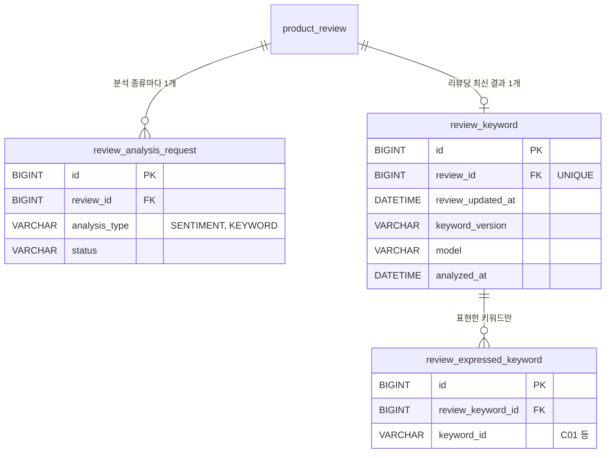

# 구매자 리뷰 키워드 설계

작성일: 2026-11-05
상태: 검토 중
관련 이슈: #387 (선행 #385, #386 / 후속 #422)
관련 결정 기록: `docs/decisions/product/387-review-keyword-list.md`, `docs/decisions/product/386-review-sentiment-integration.md`
용어: [`tools/review-analysis-bench/GLOSSARY.md`](../../tools/review-analysis-bench/GLOSSARY.md)의 "서비스 연동", "리뷰 키워드" 절. 특히 **키워드를 표현한 리뷰**(판정을 통과한 리뷰)와 **분석 완료 리뷰**(분석 종류마다 따로)를 이 문서도 같은 뜻으로 쓴다.

## 1. 개요

구매자가 리뷰를 다 읽지 않고도 상품의 장점을 알 수 있게, 여러 구매자가 반복해 칭찬한 표현을 상품 상세에 칩으로 보여 준다. 칩을 누르면 그 키워드를 표현한 리뷰만 본다. 키워드는 미리 정한 긍정 목록(`keywords.json`)에서만 나오고, 리뷰마다 목록의 키워드를 표현했는지 Jev로 판정한다. 분석은 #386의 분석 요청 표와 작업자 구조를 그대로 쓰되, 감성 분석과 요청·결과·작업자를 분리한다.

## 2. 요구사항

### 2.1 결정된 사항

- 리뷰 등록·수정·삭제를 계기로 키워드 분석 요청(`analysis_type = KEYWORD`)을 감성 요청과 따로 만든다. 계기와 규칙은 감성 분석과 같다.
- 작업자는 리뷰 상품의 **현재 하위 분류**에 해당하는 키워드(분류당 12~30개)를 Jev 요청 1회에 담아 묻는다.
- "말함" 확률 0.9 이상인 키워드만 저장한다. 구체적인 식감 키워드(C18·C19·C20·C21·C22·C23·C26·C28)가 하나라도 있으면 "식감이 좋아요"(C25)는 저장하지 않는다. (ADR #387, 평가용 정밀도 0.942를 낸 고정 설정)
- 결과는 리뷰당 한 행이고, 분석한 리뷰 수정 시각, 목록 버전, 모델을 남긴다.
- 키워드 작업자(퍼사드·서비스·스케줄러)는 감성 작업자와 따로 둔다. 꺼내기(`FOR UPDATE SKIP LOCKED` + 10분 임대), 백오프(1분·5분·30분·2시간), 401·403 쉬기(5분), 삭제·내용 없음 처리는 #386과 같은 규칙이다.
- 분모(분석 완료 리뷰 수)는 삭제되지 않았고 키워드 결과가 리뷰의 현재 수정 시각으로 낸 리뷰다. 키워드 0개 리뷰는 넣고, 내용 없음(SKIPPED)·삭제(CANCELLED)·미분석은 뺀다.
- 집계는 요청마다 GROUP BY 쿼리로 구한다. 캐시와 집계 표는 두지 않는다.
- 셀 때는 **현재 목록에 있고 상품의 현재 하위 분류에 적용되는** 키워드만 센다.
- 노출 조건: 분석 완료 리뷰 10개 이상인 상품에서, 리뷰 3개 이상이 표현한 키워드를 표현한 리뷰 수 순으로 최대 10개 내린다. 조건을 못 채우면 빈 목록이다.
- 리뷰 목록 필터는 키워드 ID(`?keyword=C02`)로 받는다. 현재 목록에 없는 ID는 400이다. 필터 결과 수와 키워드를 표현한 리뷰 수는 같은 조건으로 세어 같아야 한다.
- 기존 리뷰는 백필 마이그레이션으로 `KEYWORD` 대기 요청을 넣는다.
- 상품 분류가 바뀌거나 목록 버전이 올라도 기존 리뷰를 다시 분석하지 않는다(#422). 그 사이 새 분류·새 키워드는 기존 리뷰에 물은 적이 없어, 분모에는 들지만 표현한 리뷰로는 잡히지 않는다. 칩이 적게 나오는 쪽으로만 틀리고 잘못된 칩은 뜨지 않으므로 감수한다. 분류가 바뀔 때 요청을 되돌리면 상품 쪽이 리뷰 분석 요청을 알아야 한다.
- 식감 규칙의 키워드 ID(C18·C19·C20·C21·C22·C23·C25·C26·C28)가 목록에 있는지 목록 로더가 기동할 때 검사하고, 없으면 기동을 실패시킨다. 목록이 바뀌어 규칙이 조용히 엉뚱하게 동작하는 것을 막는다. 문구까지는 검사하지 않는다.
- Jev 답에 `probabilities.mentioned`가 없으면 그 요청을 최종 실패로 본다. 0으로 보면 응답 형식이 바뀌었을 때 모든 리뷰가 "키워드 0개"로 조용히 완료되어 분모만 늘고 칩이 사라진다.
- Jev 요청은 정밀도를 잰 실험 조건에 맞춘다. 상품명과 본문만 보내고 옵션명은 보내지 않는다. 선택지 순서는 #386과 같이 `new Random(reviewId)`로 섞는다. 실험(mulberry32)과 순서는 다르지만 "리뷰 ID를 시드로 섞는다"는 조건은 같다.
- "말함/안 말함" 선택지 설명을 실험 코드(`list.ts`의 `CHOICES`)에서 `keywords.json`의 `choices`로 한 글자도 고치지 않고 옮기고, 버전은 v0.3을 유지한다. 문구를 고치면 v0.4로 올리고 정밀도를 다시 잰다. 선택지 이름 "말함"은 측정 조건이라 남긴 질문 문구이고 도메인 용어가 아니다.
- 상품 분류에 묻지 않는 키워드로 필터하면 빈 페이지다. 셀 때 분류로 거르는 규칙과 결과가 같다.
- 분석 완료 리뷰가 10개 미만이어도 `analyzedReviewCount`를 내린다. 화면이 "리뷰가 더 쌓이면 보여요" 같은 안내를 고를 수 있다.
- Jev 호출이 리뷰당 두 배가 되고 백필 때 몰리는 것을 받아들인다. Jev가 싸서 비용을 감당할 수 있다(사용자 확인). 속도 조절은 넣지 않고, 429는 재시도로 버틴다.

### 2.2 가정

| 가정 | 이유 | 다르면 바뀌는 것 |
|---|---|---|
| `keywords.json`을 `product/src/main/resources/review-analysis/`로 옮기고 기동할 때 검사해 틀리면 기동 실패 | `criteria.json`과 같은 방식. 목록을 잘못 고친 채 배포되는 것을 막는다 | 로더의 검사 항목 |
| 표현한 리뷰 수가 같으면 키워드 ID 순으로 정렬 | 응답 순서가 실행마다 달라지지 않게 한다 | 정렬 조건 |
| 기준값(분모 10, 표현한 리뷰 3, 최대 10, 확률 0.9)은 상수 | ADR이 0.9와 식감 규칙을 고정했다. 설정으로 빼면 근거 없이 바뀔 수 있다 | 설정 클래스 추가 |
| 필터를 건 리뷰 목록의 정렬·페이지는 지금 목록과 같다(최신 ID 순, 20개) | 기존 화면과 같은 동작 | 쿼리 정렬 |
| 상품 행이 없으면(외래키 검사를 끄고 지운 경우) 키워드 요청을 취소한다 | 분류를 모르면 물을 키워드를 정할 수 없다. #386이 리뷰 행이 없을 때 취소하는 것과 같은 판단 | 작업자의 꺼내기 판별 |

### 2.3 범위 제외

- 부정 키워드 노출, 판매자 센터 노출, 관리자 화면 목록 편집
- 서비스에서 비슷한 표현 자동 묶기
- 목록 변경 시 기존 리뷰 일괄 재분석(#422)
- 실제 리뷰로 정밀도 다시 재기

## 3. 현재 코드베이스 분석

- Spring Boot 4 / Java 25, Spring Data JPA(JPQL `@Query`), Flyway(`V<yyyyMMddHHmm>__product__<설명>.sql`), MySQL InnoDB. 엔티티는 `BaseTime`을 상속하고 `catalog = ProductSchema.NAME`을 쓴다. 분석 표는 `product_` 접두사 없이 `review_*`이다(#386, 제약 이름 64자 한도).
- 분석 요청 표 `review_analysis_request`는 `(review_id, analysis_type)` UNIQUE이고, 꺼내기 인덱스가 `analysis_type`을 맨 앞에 둔다. 키워드 종류를 더하는 것을 미리 염두에 둔 설계라 표 구조는 바꾸지 않는다.
- 감성 쪽 구조(재사용할 틀):
  - `ReviewSentimentAnalysisScheduler` → `ReviewSentimentAnalysisFacade.analyzePending()` → `ReviewSentimentService.findPendingTargets / complete / fail`
  - 분석기 계약 `review/client/ReviewSentimentAnalyzer`, 구현 `client/jev/JevReviewSentimentAnalyzer`, 기준 로더 `client/ReviewSentimentCriteria`
  - 결과 `ReviewSentiment`(리뷰당 1행) + `ReviewAspectSentiment`(언급된 항목만 행)
- `ProductReviewService`는 리뷰 등록 시 `SENTIMENT` 요청을 만들고, 별점·본문 수정 시 `requestReanalysis()`로 `SENTIMENT` 요청만 되돌린다. 두 곳 모두 `KEYWORD`도 다뤄야 한다.
- `JevResponse.Answer`는 `type`, `choice`만 있다. 확률 필드가 없다.
- `Product.category`는 `ProductCategory`(8개, NOT NULL)이고 `keywords.json`의 `categories` 값과 이름이 같다.
- `GET /api/v1/products/{productId}/reviews`는 공개 엔드포인트다(`SecurityConfig`의 `PublicEndpoint`). 새 키워드 집계 API도 공개로 등록해야 한다.

## 4. DB 설계

### 4.1 ERD



### 4.2 테이블 정의

**`review_analysis_request`** (변경 없음, 값만 추가)

- `analysis_type`에 `KEYWORD`가 들어온다. 칼럼 주석 `'SENTIMENT'`는 새 마이그레이션에서 `'SENTIMENT, KEYWORD'`로 고친다. 운영자가 SQL로 상태를 볼 때 종류 목록을 주석에서 보게 하려는 것이다(#386과 같은 이유).

**`review_keyword`** — 리뷰의 최신 키워드 분석 결과. 리뷰마다 한 행

| 컬럼 | 타입 | NULL | 기본값 | 설명 |
|---|---|---|---|---|
| id | BIGINT AUTO_INCREMENT | N | | PK |
| review_id | BIGINT | N | | `product_review.id` |
| review_updated_at | DATETIME(6) | N | | 분석할 때 읽은 리뷰의 수정 시각. 집계의 "지금 리뷰로 낸 결과" 판별 기준 |
| keyword_version | VARCHAR(20) | N | | 분석에 쓴 `keywords.json` 버전. #422가 재분석 대상을 고를 때 쓴다 |
| model | VARCHAR(50) | N | | 분석에 쓴 모델(설정 값) |
| analyzed_at | DATETIME(6) | N | | |
| created_at, updated_at | DATETIME(6) | N | | |

- `uk_review_keyword_review_id UNIQUE (review_id)`: 리뷰당 결과 한 행. 재분석하면 고쳐 쓴다.
- `fk_review_keyword_review_id`: 감성 결과 표와 같게 FK를 건다.

**`review_expressed_keyword`** — 리뷰가 표현한 키워드. 키워드 판정을 통과한 키워드만 행이 있다

| 컬럼 | 타입 | NULL | 기본값 | 설명 |
|---|---|---|---|---|
| id | BIGINT AUTO_INCREMENT | N | | PK |
| review_keyword_id | BIGINT | N | | `review_keyword.id` |
| keyword_id | VARCHAR(10) | N | | `keywords.json`의 키워드 ID(C01 등) |
| created_at, updated_at | DATETIME(6) | N | | |

- `uk_review_expressed_keyword_review_keyword_id_keyword_id UNIQUE (review_keyword_id, keyword_id)`: 같은 결과에 같은 키워드가 두 번 들어가지 않게 한다. 이름 길이는 56자로 64자 한도 안이다.
- `idx_review_expressed_keyword_keyword_id (keyword_id)`: 키워드 필터가 키워드로 결과를 찾는다. 상품 조건은 리뷰 쪽에서 거르므로 상품별 리뷰 수가 수백 개 규모에서는 이 인덱스로 충분하다. 느려지면 `review_id`를 `review_expressed_keyword`에 내려 `(keyword_id, review_id)`를 검토한다(미결 2번).
- `fk_review_expressed_keyword_review_keyword_id`: 결과 행을 가리킨다.

### 4.3 상태 전이

키워드 요청의 상태 전이는 #386의 `ReviewAnalysisRequest`와 같다. 새 상태는 없다.

| 현재 | 사건 | 다음 |
|---|---|---|
| PENDING | 분석 성공 | COMPLETED |
| PENDING | 재시도할 실패(429·5xx·네트워크) | PENDING (백오프) |
| PENDING | 최종 실패 또는 재시도 소진 | FAILED |
| PENDING | 꺼낼 때 리뷰가 삭제됨, 리뷰 행 없음, 상품 행 없음 | CANCELLED |
| PENDING | 꺼낼 때 내용 없는 리뷰 | SKIPPED |
| 어느 상태든 | 별점·본문 수정 | PENDING (처음부터) |

### 4.4 설계 결정과 이유

| 결정 | 이유 | 검토한 대안 |
|---|---|---|
| 0.9 이상 + 식감 규칙을 적용한 키워드만 행으로 저장 (인터뷰 Q1) | 집계·필터가 "행이 있으면 표현함"으로 단순해진다. ADR이 기준을 고정했으므로 기준을 바꿀 일은 #422 재분석과 함께 온다 | 물은 키워드마다 확률 저장: 리뷰당 최대 30행이고, 집계와 필터 쿼리 모두에 확률 조건과 식감 규칙을 넣어야 한다 |
| 결과 표와 `review_expressed_keyword`을 감성 쪽과 같은 모양(1행 + 자식 행)으로 | 집계 신선도 규칙(`review_updated_at = r.updated_at`)을 같은 방식으로 쓴다. 키워드 0개 리뷰도 결과 행이 있어 분모에 든다 | `review_expressed_keyword`만 두기: 키워드 0개 리뷰를 분모에 넣을 수 없다 |
| 키워드는 ID 문자열로 저장하고 문구·분석 항목은 저장하지 않음 | 화면 문구는 현재 목록이 통제한다(인터뷰 Q6). 문구를 저장하면 목록과 어긋난다 | 문구 스냅샷: 고친 문구가 기존 리뷰에 반영되지 않는다 |
| 셀 때 현재 목록·현재 분류로 거르는 일은 쿼리가 아니라 서비스가 함 | 목록은 DB가 아니라 리소스 파일에 있다. 쿼리는 키워드 ID별 개수를 모두 내고, 서비스가 현재 목록과 상품 분류로 거른 뒤 3개 이상·상위 10개를 고른다 | 쿼리에 `IN (:keywordIds)`를 넣기: 가능하지만 분류별 ID 목록을 넘겨야 하고 결과는 같다. 구현 때 더 단순한 쪽을 고른다 |
| 감성과 같은 FK를 둠 | #386과 같은 판단. 운영 DB에서 FK 검사를 끄고 지우는 경우는 작업자가 취소로 처리한다 | FK 없음: 다른 분석 표와 규칙이 어긋난다 |
| 요청 표는 그대로 두고 주석만 고치는 마이그레이션 | 표 생성 파일은 이미 적용되어 고치지 않는다 | 새 요청 표: 꺼내기 인덱스가 이미 종류별로 나뉘어 있어 필요 없다 |

### 4.5 마이그레이션 초안

파일명의 시각은 구현할 때 정한다.

`V202611xxxxxx__product__create_review_keyword_tables.sql`

```sql
-- 리뷰의 최신 키워드 분석 결과. 리뷰마다 한 행
-- 키워드 0개인 리뷰도 행이 있어야 분석 완료 리뷰 수(분모)에 든다
CREATE TABLE review_keyword (
    id BIGINT NOT NULL AUTO_INCREMENT,
    review_id BIGINT NOT NULL,
    review_updated_at DATETIME(6) NOT NULL COMMENT '분석할 때 읽은 리뷰의 수정 시각',
    keyword_version VARCHAR(20) NOT NULL COMMENT '분석에 쓴 키워드 목록(keywords.json) 버전',
    model VARCHAR(50) NOT NULL COMMENT '분석에 쓴 모델',
    analyzed_at DATETIME(6) NOT NULL,
    created_at DATETIME(6) NOT NULL,
    updated_at DATETIME(6) NOT NULL,
    PRIMARY KEY (id),
    CONSTRAINT uk_review_keyword_review_id UNIQUE (review_id),
    CONSTRAINT fk_review_keyword_review_id FOREIGN KEY (review_id) REFERENCES product_review (id)
) ENGINE = InnoDB DEFAULT CHARSET = utf8mb4;

-- 리뷰가 표현한 키워드. 확률 0.9 이상이고 식감 규칙을 적용한 뒤 남은 키워드만 행이 있다
CREATE TABLE review_expressed_keyword (
    id BIGINT NOT NULL AUTO_INCREMENT,
    review_keyword_id BIGINT NOT NULL,
    keyword_id VARCHAR(10) NOT NULL COMMENT 'keywords.json의 키워드 ID',
    created_at DATETIME(6) NOT NULL,
    updated_at DATETIME(6) NOT NULL,
    PRIMARY KEY (id),
    CONSTRAINT uk_review_expressed_keyword_review_keyword_id_keyword_id UNIQUE (review_keyword_id, keyword_id),
    CONSTRAINT fk_review_expressed_keyword_review_keyword_id FOREIGN KEY (review_keyword_id) REFERENCES review_keyword (id)
) ENGINE = InnoDB DEFAULT CHARSET = utf8mb4;

-- 리뷰 목록의 키워드 필터가 키워드로 결과를 찾는다
CREATE INDEX idx_review_expressed_keyword_keyword_id ON review_expressed_keyword (keyword_id);

ALTER TABLE review_analysis_request
    MODIFY analysis_type VARCHAR(20) NOT NULL COMMENT 'SENTIMENT, KEYWORD';
```

`V202611xxxxxx__product__insert_pending_review_keyword_requests.sql`

```sql
-- 키워드 분석 전에 쓰인 기존 리뷰도 분석되도록 삭제되지 않은 리뷰마다 대기 요청을 넣는다
-- 표를 만드는 파일과 나눈 이유: 이 파일만 다시 실행해 백필 결과를 통합 테스트로 확인한다
INSERT INTO review_analysis_request (review_id, analysis_type, status, attempt_count, next_attempt_at, created_at, updated_at)
SELECT id, 'KEYWORD', 'PENDING', 0, NOW(6), NOW(6), NOW(6)
FROM product_review
WHERE deleted_at IS NULL;
```

- `MODIFY`는 칼럼 정의를 통째로 다시 쓰므로 타입·NULL 여부를 기존과 같게 적는다. 구현할 때 `migration` 스킬로 확인한다.

## 5. 구현 방식

### 5.1 모듈·패키지 배치

모두 `product` 모듈의 `review` 패키지 안이다. 모듈 경계와 `ArchitectureTest` 갱신은 필요 없다.

| 패키지 | 추가 |
|---|---|
| `review/domain` | `ReviewAnalysisType.KEYWORD`, `ReviewKeyword`(결과), `ReviewExpressedKeyword`(표현한 키워드), `ReviewKeywordAspect`(TASTE·FRESHNESS·CONDITION·PACKAGING·DELIVERY·PRICE·OTHER) |
| `review/client` | `ReviewKeywordAnalyzer`(계약), `ReviewKeywordList`(목록 로더) |
| `review/client/jev` | `JevReviewKeywordAnalyzer`, `JevResponse.Answer`에 `probabilities` 추가 |
| `review/repository` | `ReviewKeywordRepository`(결과 저장, 집계 쿼리), `ReviewKeywordCount`, `ProductReviewRepository`에 키워드 필터 조회 |
| `review/service` | `ReviewKeywordAnalysisScheduler`, `ReviewKeywordAnalysisFacade`, `ReviewKeywordService`, `ProductReviewService` 수정 |
| `review/controller` | `ProductReviewKeywordController` + `Spec`, `ProductReviewController.getProductReviews`에 `keyword` 파라미터 |

- 분석 항목은 `ReviewAspect`에 `OTHER`를 더하지 않고 `ReviewKeywordAspect`를 따로 둔다. 감성 분석이 `ReviewAspect.values()`를 돌며 질문 키와 대조하므로 `OTHER`를 넣으면 감성 기동 검사가 깨진다.
- 식감 규칙(C18… → C25 제외)은 Jev 구현이 아니라 도메인 쪽(`ReviewKeywordList` 또는 서비스의 판정 단계)에 둔다. 분석기를 바꿔도 같은 규칙이 적용되게 하려는 것이다. 규칙의 키워드 ID는 `keywords.json`에 `suppressedBy` 같은 필드로 넣지 않고 코드 상수로 둔다. ADR이 "판정 기준을 코드로 옮긴 것"으로 고정했고, 목록 형식을 늘리지 않기 위해서다. 대신 목록 로더가 이 ID들이 목록에 있는지 기동할 때 검사한다(2.1).

### 5.2 API

| 메서드 | 경로 | 요청 | 응답 | 주요 에러 |
|---|---|---|---|---|
| GET | `/api/v1/products/{productId}/review-keywords` | 없음 (공개) | `ProductReviewKeywordsResponse` | 404 상품 없음 |
| GET | `/api/v1/products/{productId}/reviews` | `page`, `size`, **`keyword`(선택, 예: C02)** | 기존 `ProductPageResponse<ProductReviewResponse>` | 400 목록에 없는 키워드 |

`ProductReviewKeywordsResponse`

```json
{
  "analyzedReviewCount": 42,
  "keywords": [
    { "keywordId": "C02", "phrase": "달아요", "aspect": "TASTE", "reviewCount": 17 },
    { "keywordId": "C18", "phrase": "아삭해요", "aspect": "TASTE", "reviewCount": 9 }
  ]
}
```

- 분모가 10 미만이거나 리뷰 3개 이상이 표현한 키워드가 없으면 `keywords`는 빈 배열이다. `analyzedReviewCount`는 그때도 내린다(2.1).
- 키워드 필터는 현재 목록에 있는 ID면 상품 분류와 표현한 리뷰 수에 관계없이 받는다. 칩에 안 뜬 키워드로 걸러도 결과는 맞게 나온다. 분류에 해당하지 않는 키워드면 빈 페이지가 나온다(2.1).
- 응답 DTO에는 Swagger `@Schema`를 붙이고 `*Spec` 인터페이스에 문서를 둔다(`api.md`).

### 5.3 핵심 흐름

**① 리뷰 등록·수정 (기존 트랜잭션에 추가)**

1. `ProductReviewService.create`: 리뷰 저장 트랜잭션 안에서 `SENTIMENT`와 `KEYWORD` 대기 요청을 함께 저장한다.
2. `ProductReviewService.update`: 별점·본문이 바뀌면 `requestReanalysis(reviewId)`가 두 종류의 요청을 모두 처음 대기로 되돌린다(없으면 만든다).
3. 삭제는 요청을 건드리지 않는다. 작업자가 꺼낼 때 취소한다(#386과 같음).

**② 키워드 작업자** (`ReviewKeywordAnalysisScheduler`, 5초마다, 운영 설정에서만 켬)

1. `ReviewKeywordService.findPendingTargets(20)` — 쓰기 트랜잭션
   - `KEYWORD` 대기 요청 중 다음 시도 시각이 지난 것을 `FOR UPDATE SKIP LOCKED`로 꺼내고 10분 임대를 건다.
   - 리뷰 삭제·리뷰 행 없음·상품 행 없음 → CANCELLED, 내용 없음 → SKIPPED로 끝낸다.
   - 남은 요청마다 대상(리뷰 ID, 리뷰 수정 시각, 상품명, 본문, **상품 하위 분류**)을 만든다.
2. `ReviewKeywordAnalyzer.analyze(target)` — **트랜잭션 밖**, Jev 호출
   - `ReviewKeywordList.keywordsFor(category)`로 물을 키워드를 고른다.
   - 키워드마다 질문 하나: 지시문 + `이 리뷰는 "<문구>"라고 말하나?` + 판정 기준. 선택지 두 개(말함/안 말함)는 `new Random(reviewId)`로 섞는다.
   - 응답에서 키워드마다 `probabilities.mentioned`를 읽어 키워드 ID → 확률 맵을 돌려준다. 답이나 확률이 없으면 최종 실패다.
3. 판정: 확률 0.9 이상만 남기고 식감 규칙을 적용한다.
4. `ReviewKeywordService.complete(target, result)` — 짧은 쓰기 트랜잭션
   - 리뷰 행을 먼저 잠근 뒤 요청을 읽는다. 리뷰 수정 시각이 대상과 다르면 결과를 버리고 요청을 건드리지 않는다.
   - `review_keyword`가 있으면 고쳐 쓰고, `review_expressed_keyword` 행은 같은 키워드는 두고 빠진 것은 지우고 새 것은 더한다. 비우고 다시 넣으면 Hibernate가 INSERT를 DELETE보다 먼저 보내 UNIQUE에 걸린다(#386에서 확인).
   - 요청을 COMPLETED로 바꾼다.
5. 실패는 `ReviewKeywordService.fail(...)`이 #386과 같은 규칙으로 처리한다. `ReviewAnalyzerUnavailableException`이면 퍼사드가 이번 실행의 남은 요청을 부르지 않고 5분 쉰다. 쉬는 상태는 키워드 퍼사드가 따로 든다.

**③ 키워드 집계** (`GET /review-keywords`, 읽기 트랜잭션)

1. 상품을 읽어 하위 분류를 얻는다. 없으면 404.
2. 분모: 상품의 삭제되지 않은 리뷰 중 `review_keyword.review_updated_at = product_review.updated_at`인 리뷰 수.
3. 분모가 10 미만이면 빈 목록.
4. 같은 조건의 리뷰에서 `keyword_id`별 표현한 리뷰 수를 GROUP BY로 센다.
5. 현재 목록에 있고 상품 분류에 적용되는 키워드만 남기고, 3개 이상인 것을 표현한 리뷰 수 내림차순·키워드 ID 오름차순으로 10개 고른다. 문구와 분석 항목은 목록에서 붙인다.

**④ 키워드 필터 리뷰 목록**

1. `keyword`가 현재 목록에 없으면 400.
2. 상품 분류에 적용되지 않는 키워드면 빈 페이지.
3. 상품의 삭제되지 않은 리뷰 중, 결과가 현재 수정 시각으로 낸 것이고 그 결과에 해당 키워드 행이 있는 리뷰를 ID 내림차순으로 페이지 조회한다. ③의 4단계와 같은 조건이라 전체 개수가 칩의 표현한 리뷰 수와 같다.

### 5.4 모듈 간 연동

해당 없음 — 모두 `product` 모듈 안의 일이다. 외부 연동은 Jev 하나이고, 기존 `jevRestClient` 빈을 쓴다. `RestClient` 빈이 둘이라 필드 이름(`jevRestClient`)으로 고른다는 #386의 주의를 지킨다.

### 5.5 에러 코드

| 코드 | HTTP | 상황 |
|---|---|---|
| `REVIEW_KEYWORD_NOT_FOUND` (`ProductReviewErrorCode`) | 400 | 리뷰 목록의 `keyword`가 현재 목록에 없는 ID |
| (기존) 상품 없음 | 404 | 키워드 집계·리뷰 목록에서 상품이 없을 때. 기존 리뷰 목록과 같은 코드를 쓴다 |

## 6. 필요 기술

### 6.1 이미 있는 것

- 분석 요청 표, 꺼내기 잠금과 임대, 백오프, 인증 거절 쉬기(#386)
- Jev `RestClient` 빈과 `JevProperties`(모델, 키, 시간 초과)
- Jackson 기반 리소스 로더 방식(`ReviewSentimentCriteria`)

### 6.2 새로 추가할 것

해당 없음 — 새 라이브러리나 인프라는 없다. 집계 캐시도 두지 않는다(인터뷰 Q5). 상세 화면이 느려지는 증거가 생기면 그때 검토한다.

### 6.3 인프라·설정 요청

- 키워드 작업자를 켜는 설정 속성(예: `product.review.keyword-analysis.enabled`)을 감성 것과 따로 둔다. 운영 설정에서 둘 다 켠다. 따로 두는 이유는 한쪽만 끄고 운영할 수 있게 하려는 것이다.
- `JEV_API_KEY`는 감성과 같이 쓴다. 추가 요청 없음.
- Jev 호출량이 대략 두 배가 된다(리뷰당 감성 1회 + 키워드 1회, 키워드 요청의 입력은 약 9,600토큰). 백필 직후 일시적으로 몰린다. 비용은 감당할 수 있다고 확인했다(2.1).

## 7. 구현 계획

### 7.1 파일 목록

1. **마이그레이션**: `create_review_keyword_tables.sql`, `insert_pending_review_keyword_requests.sql`
2. **리소스**: `review-analysis/keywords.json` (v0.3 + `choices`)
3. **도메인**: `ReviewAnalysisType`(KEYWORD), `ReviewKeyword`, `ReviewExpressedKeyword`, `ReviewKeywordAspect`
4. **클라이언트**: `ReviewKeywordList`, `ReviewKeywordAnalyzer`, `JevReviewKeywordAnalyzer`, `JevResponse`(확률)
5. **리포지토리**: `ReviewKeywordRepository`, `ReviewKeywordCount`, `ProductReviewRepository`(필터 조회)
6. **서비스**: `ReviewKeywordService`, `ReviewKeywordAnalysisFacade`, `ReviewKeywordAnalysisScheduler`, `ProductReviewService`(요청 생성·재분석), DTO(`ReviewKeywordTarget`, `ReviewKeywordAnalysis`, `ProductReviewKeywordsResult`)
7. **컨트롤러**: `ProductReviewKeywordController` + `Spec`, 응답 DTO, `ProductReviewController`(필터 파라미터)
8. **설정**: 작업자 켜기 속성, `SecurityConfig` 공개 엔드포인트 추가
9. **예외**: `ProductReviewErrorCode.REVIEW_KEYWORD_NOT_FOUND`
10. **테스트 지원**: `testsupport`에 Fake 키워드 분석기

### 7.2 작업 순서

각 커밋은 `Feat:`/`Test:` 형식에 `Ref: #387`을 붙인다.

1. 키워드 목록 리소스와 로더(기동 검사 포함) + 로더 단위 테스트
2. 결과 표 마이그레이션, 엔티티, 요청 종류 추가, 백필 마이그레이션 + 백필 통합 테스트
3. 리뷰 등록·수정 시 키워드 요청 생성·되돌리기
4. Jev 키워드 분석기(확률 읽기, 선택지 섞기) + 판정(0.9, 식감 규칙)
5. 키워드 작업자(꺼내기, 완료, 실패, 쉬기) + 통합 테스트
6. 키워드 집계 API
7. 리뷰 목록 키워드 필터
8. 공개 엔드포인트·설정 정리, ADR #387 갱신(`session-summary`)

### 7.3 테스트 계획

| 종류 | 검증 |
|---|---|
| 단위 | 목록 로더: 분류 이름·분석 항목·분류당 30개 초과·ID 중복·식감 규칙 ID 누락이면 기동 실패. 분류별 적용 키워드 고르기(ALL 포함) |
| 단위 | 판정: 0.9 경계(0.9는 포함, 0.89는 제외), 식감 키워드가 있으면 C25 제외, 없으면 유지 |
| 단위 | Jev 분석기: 같은 리뷰 ID면 같은 선택지 순서, 확률 없으면 최종 실패, 401·403은 `ReviewAnalyzerUnavailableException` |
| 단위 | 퍼사드: 인증 거절 뒤 5분 쉬기(시계를 넘겨 확인) |
| 단위 | 집계 선택: 3개 미만 제외, 동률은 ID 순, 10개 자르기, 현재 분류에 없는 키워드 제외 |
| 통합 | 리뷰 등록 시 SENTIMENT·KEYWORD 요청 두 개, 수정 시 둘 다 대기로 되돌림 |
| 통합 | 작업자: 완료 저장, 재분석 시 키워드 행 고쳐 쓰기(UNIQUE 위반 없음), 분석 도중 수정이면 결과 버림, 삭제·내용 없음·상품 없음 처리 |
| 통합 | 키워드 실패가 감성 요청·결과에 영향 없음 (완료 조건) |
| 통합 | 분모 10 미만이면 빈 목록, 이상이면 응답. 수정 후 재분석 전인 리뷰는 분모와 표현한 리뷰 수에서 빠짐 |
| 통합 | 키워드 필터 결과의 전체 개수 = 집계 응답의 표현한 리뷰 수 (완료 조건) |
| 통합 | 목록에 없는 키워드 400, 분류에 해당 없는 키워드 빈 페이지 |
| 통합 | 백필: 삭제되지 않은 리뷰마다 KEYWORD 대기 요청 |

정밀도 0.9 완료 조건은 #385 보관 브랜치의 평가 결과(0.942)를 근거로 하고, 서비스 테스트로 다시 재지 않는다. 서비스가 실험과 같은 요청을 보내는지는 Jev 분석기 단위 테스트에서 요청 본문 모양으로 확인한다.

## 8. 미결 사항

설계 검토(2026-11-05)에서 처음 미결로 둔 1~6번(Jev 호출량, 섞기 함수, 옵션명, 선택지 문구의 버전, 분류에 해당하지 않는 필터, `analyzedReviewCount`)은 결정으로 옮겼다(2.1). 표·클래스 이름은 용어집이 "언급"을 피할 말로 정해 `mention` 대신 `review_expressed_keyword` / `ReviewExpressedKeyword`로 정했다. 남은 것:

1. **작업자 설정 속성 이름.** 구현할 때 감성 쪽 속성 이름을 보고 맞춘다.
2. **필터 인덱스.** 상품당 리뷰가 수천 개를 넘어 필터가 느려지면 `review_expressed_keyword`에 `review_id`를 내리는 것을 검토한다. 지금 규모에서는 하지 않는다.
