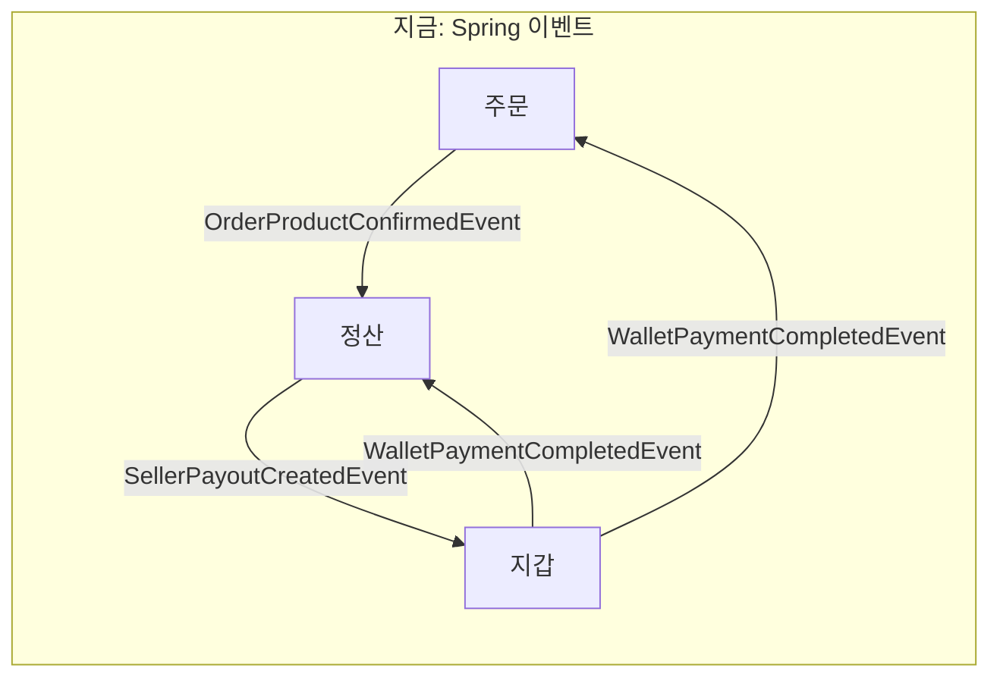
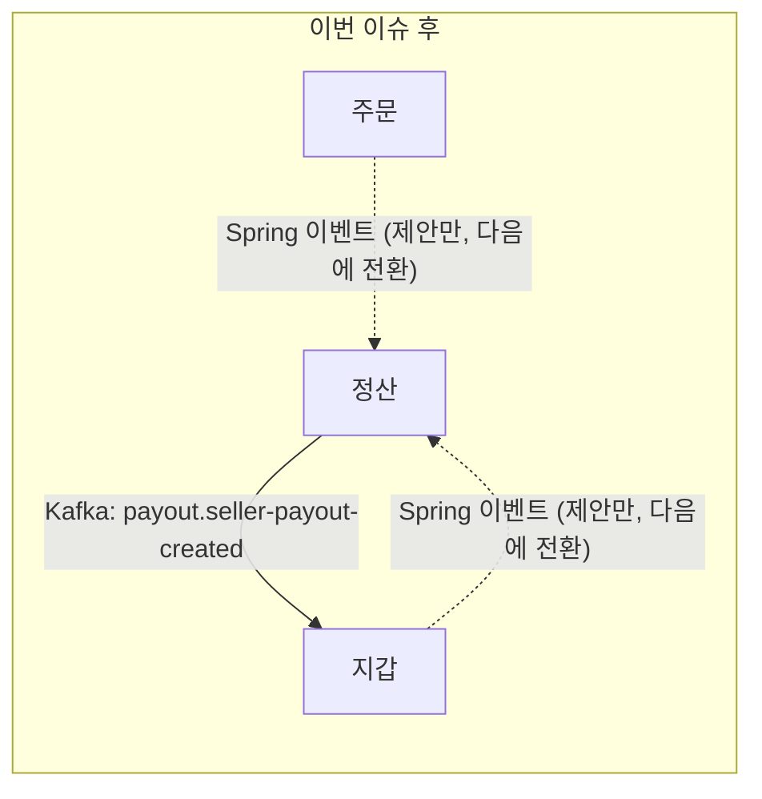

# 정산 이벤트 Kafka 전환 — 주문·지갑 담당과 이야기할 것

> 2026-10-30, 정산 담당 작성. 이슈: #339 (관련 문서 수정: #340)
> 목적: 정산이 이벤트를 Kafka로 바꾸기 전에, 반대쪽 끝을 맡은 주문·지갑과 약속과 순서를 맞춘다.

## 1. 한 줄 요약
정산은 지갑으로 보내는 정산금 이벤트 1개를 Kafka로 바꾼다. 지갑 리스너도 같은 날 바뀌어야 하고, 정산이 받는 이벤트 2개는 토픽 이름과 키를 먼저 맞춰 두자고 제안한다.

## 2. 배경 (회의에서 정한 것)
- 조회는 HTTP(동기), 생성·수정·삭제는 메시지 브로커(비동기). **Spring 이벤트는 없앤다.**
- 순서: 메시지 브로커 → saga(코레오그래피) → outbox → 재시도(지수 백오프) → Dead Letter + Slack 알림 + 수동 처리
- 모듈 간 이벤트는 공통 클래스(`common.event`)를 같이 쓰지 않고 **각 모듈이 자기 DTO를 갖는다.** 보내는 쪽과 받는 쪽은 메시지 모양(JSON 필드 이름·타입·단위)으로 약속한다. 컨벤션·`ArchitectureTest` 수정은 #340에서 한다.
- 이번은 **첫 단계(Kafka로 보내고 받기)만** 한다. outbox, 재시도, DLT는 다음 단계에서 한다.
- 다른 모듈에 영향이 가는 일은 이슈 작성자가 제안하고 리뷰어와 협의한다. 안 되면 회의로 올린다.

## 3. 지금 → 바뀐 뒤





| 이벤트 | 보내는 쪽 | 받는 쪽 | 이번에 |
|---|---|---|---|
| `SellerPayoutCreatedEvent` | 정산 | 지갑 | **정산·지갑 둘 다 Kafka로 전환** |
| `OrderProductConfirmedEvent` | 주문 | 정산 | 약속만 맞춤 |
| `WalletPaymentCompletedEvent` | 지갑 | 주문, 정산 | 약속만 맞춤 |

## 4. 제안하는 메시지 약속

| 이벤트 | 토픽 | 키 | 값 |
|---|---|---|---|
| `SellerPayoutCreatedEvent` | `payout.seller-payout-created` | `payoutId` | 아래 4-1 JSON 약속 |
| `OrderProductConfirmedEvent` | `order.order-product-confirmed` | `orderItemId` | 아래 4-2 (제안) |
| `WalletPaymentCompletedEvent` | `wallet.wallet-payment-completed` | `orderId` | 아래 4-2 (제안) |

- **토픽 이름 `<보내는 모듈>.<이벤트>`**: 팀에 아직 규칙이 없다. 정산이 첫 사례라 이 이름이 사실상 기준이 되니, 괜찮은지 같이 봐 주세요.
- **키 = 업무 식별자**: 같은 대상의 메시지는 같은 파티션에 들어가 순서가 지켜진다. 받는 쪽은 이 값으로 중복을 막는다(지갑은 이미 `payoutId`로 막고 있음).
- **값 = JSON 약속**: 보내는 쪽과 받는 쪽이 각자 자기 모듈에 DTO를 두고, 필드 이름·타입·단위만 맞춘다. #318 설정상 메시지에 보내는 쪽 클래스 이름(타입 헤더)을 싣지 않으므로, 받는 리스너는 자기 DTO 타입으로 읽도록 지정한다.

### 4-1. 정산이 보내는 JSON (`payout.seller-payout-created`)

```json
{"payoutId": 12, "payeeId": 5, "amount": 9700, "createdAt": "2026-10-30T14:00:00"}
```

| 필드 | 타입 | 뜻 |
|---|---|---|
| `payoutId` | 숫자 | 정산 ID. 지갑의 중복 입금 방지 기준 |
| `payeeId` | 숫자 | 판매자 회원 ID. null 아님 (시스템 몫은 보내지 않음) |
| `amount` | 숫자 | 원 단위, 항상 1 이상 (0원 이하는 보내지 않음, #106) |
| `createdAt` | 문자열 (`yyyy-MM-ddTHH:mm:ss`) | 정산 확정 시각, Asia/Seoul |

- 필드는 지금 `SellerPayoutCreatedEvent`와 같아서, 지갑은 지금 받는 값을 그대로 쓸 수 있다.
- `createdAt`의 실제 문자열 모양은 구현할 때 통합 테스트로 확인해 이 표에 맞춘다.

### 4-2. 정산이 받는 JSON (제안)
- 지금 레코드와 같은 필드 이름으로 보내 주기를 제안한다. 그러면 정산 쪽 변환 코드가 바뀌지 않는다.
  - `order.order-product-confirmed`: `orderId`, `orderItemId`, `sellerId`, `totalItemPrice`, `sellerShippingPrice`
  - `wallet.wallet-payment-completed`: `orderId`, `buyerId`, `amount`, `paidAt`
- 필드마다 단위와 null의 뜻은 보내는 쪽이 정해 4-1처럼 적어 주기를 요청한다(#307과 같은 취지).

## 5. 지갑 담당께

**요청: `PayoutEventListener`를 Kafka 리스너로 바꾸고, 정산 PR과 같이 머지**
- 한쪽만 머지되면 정산 배치는 "발행 완료"로 끝나는데 판매자 지갑 잔액은 그대로이고, 오류 로그도 남지 않는다.
  - 예: 정산만 머지 → 판매자 10명 정산 확정 → 메시지는 토픽에 쌓이지만 지갑이 안 읽음
  - 예: 지갑만 머지 → 정산은 Spring 이벤트로 보냄 → 지갑이 못 받음
- 지금 리스너의 값 검사(`payoutId`·`payeeId`·`amount` 없음, `amount` ≤ 0이면 입금하지 않고 로그만 남김)와 `payoutId` 중복 방지는 그대로 쓸 수 있다.

**제안: 받는 DTO를 지갑 안에 두기**
- `common.event.SellerPayoutCreatedEvent` 대신 지갑 `event` 패키지에 받는 DTO를 두고 4-1 JSON 약속대로 읽는다. 정산도 보내는 DTO를 정산 안에 둔다.
- `WalletPaymentCompletedEvent`를 Kafka로 바꿀 때도 보내는 DTO를 지갑 안에 두고, 4-2의 필드 이름을 유지해 주기를 제안한다.

**확인할 것**
1. 토픽 `payout.seller-payout-created`, 키 `payoutId`, 4-1 JSON 약속이 괜찮은지
2. 같이 머지할 수 있는 시점
3. `WalletPaymentCompletedEvent`를 Kafka로 보낼 계획과 시점 (정산·주문이 받음)

## 6. 주문 담당께

**이번에 주문 코드가 바뀌는 것은 없다.**

**제안: 보내는 DTO를 주문 안에 두기**
- `OrderProductConfirmedEvent`를 Kafka로 바꿀 때 `common.event` 대신 주문 `event` 패키지에 보내는 DTO를 두고, 4-2의 필드 이름을 유지해 주기를 제안한다. 정산은 받는 DTO를 정산 안에 둔다.
- `WalletPaymentCompletedEvent`를 받을 때도 주문 안에 받는 DTO를 둔다.

**확인할 것**
1. `OrderProductConfirmedEvent`의 토픽 `order.order-product-confirmed`, 키 `orderItemId`가 괜찮은지
2. Kafka로 보내기 시작할 계획과 시점. 그때 정산 리스너도 같이 바꾼다.
3. `WalletPaymentCompletedEvent`는 주문과 정산이 모두 받는다. 아래 7-1 참고

## 7. 셋이 같이 알아야 할 점 (Spring 이벤트에서 Kafka로 바뀌면서 달라지는 것)

### 7-1. 컨슈머 그룹을 모듈마다 나눠야 한다
- #318 설정은 컨슈머 그룹 기본값이 앱 이름(`paldo-gotgan`) 하나다.
- Kafka는 **같은 그룹 안에서는 한 메시지를 한 리스너에만** 준다. `WalletPaymentCompletedEvent`를 주문과 정산이 같은 그룹으로 받으면, 어떤 결제는 주문만 받고 어떤 결제는 정산만 받는다.
  - 예: 결제 완료 10건 → 주문이 결제 완료 처리를 못 한 주문이 생기거나, 정산의 교차 검증 기록이 빠진다.
- **제안:** 리스너마다 모듈 이름으로 그룹을 지정한다(예: `@KafkaListener(groupId = "payout")`). `application.yaml` 주석에도 "서비스로 나누면 서비스마다 그룹이 달라진다"고 되어 있어 방향이 같다.

### 7-2. 보내는 시점: 커밋 전에 나갈 수 있다 (보내는 쪽이 정할 것)
- 지금 `@ApplicationModuleListener`는 **보낸 쪽이 커밋한 뒤에만** 받는다. 롤백되면 전달되지 않는다.
- `KafkaTemplate.send()`를 트랜잭션 안에서 부르면 **커밋 전에 메시지가 나간다.** 그 뒤에 롤백되면, 받는 쪽은 실제로 일어나지 않은 일을 처리한다.
  - 예: 지갑이 결제 차감 중 메시지를 보냈는데 커밋이 실패 → 주문은 결제 완료로 바뀌고 예치금은 그대로
- 정산은 이 문제가 없다. 정산의 발행(`PayoutService.publish`)은 이미 커밋된 정산을 읽어서 보내기만 하기 때문이다.
- 주문 `OrderService`의 구매확정 발행, 지갑 `OrderPaymentService`의 결제 완료 발행은 서비스 안에서 일어나므로, 전환할 때 각 팀이 정할 일이다. 근본 해결은 outbox 단계에서 한다.

### 7-3. 처리 실패 시 재처리 방식이 바뀐다
- 지금은 리스너에서 예외가 나면 Spring Modulith가 이벤트를 "미완료"로 남겨 두고 나중에 다시 처리할 수 있다(지갑 `PayoutEventListener` 주석의 "일시적 실패는 재처리 대상으로 남긴다").
- Kafka 기본 오류 처리는 **곧바로 몇 번 다시 시도하고, 그래도 실패하면 로그만 남기고 다음 메시지로 넘어간다.** 미완료로 남는 곳이 없다.
- 재시도(지수 백오프)와 DLT는 다음 단계의 일이다. **그 전까지 이 상태로 둘지** 셋이 알고 넘어가자.

## 8. 테스트
- `AbstractIntegrationTest`(공통)에 Testcontainers Kafka를 붙인다. `docs/DEVELOPMENT.md`에 "첫 Kafka 통합 테스트 때 붙인다"고 정해 둔 방식이다.
- 모든 모듈 통합 테스트가 처음 한 번 Kafka 컨테이너를 띄우는 시간(약 10~20초)만큼 길어진다. 공통 코드라 리뷰 때 같이 봐 주세요.
- 지갑 `WalletModuleTest`의 정산 이벤트 테스트(`Scenario`로 Spring 이벤트 발행)는 지갑 리스너를 바꿀 때 지갑 쪽에서 함께 바꿔야 한다.

## 9. 이번에 하지 않는 것
- outbox, 재시도(지수 백오프), DLT·Slack 알림: 다음 단계 (정산 쪽 항목은 #309에 모아 둠)
- 정산이 받는 리스너 2개의 Kafka 전환: 주문·지갑이 Kafka로 보내기 시작할 때
- layered → MSA 구조 변경: 별도 이슈

## 10. 정산이 제안하는 결론 (의견 주세요)
- [ ] 토픽 이름은 `<보내는 모듈>.<이벤트>`(예: `payout.seller-payout-created`)로 가는 게 어떨까요? 팀 기준으로 삼으면 다음 전환부터는 이름을 따로 정하지 않아도 됩니다.
- [ ] 이벤트 3개의 토픽·키는 4번 표대로, 정산이 보내는 JSON은 4-1대로, 정산이 받는 2개는 4-2처럼 지금 필드 이름을 유지하는 게 어떨까요?
- [ ] 보내는 DTO와 받는 DTO는 각 모듈의 `event` 패키지에 두는 게 어떨까요? (컨벤션 2.1)
- [ ] 컨슈머 그룹은 모듈 이름(`payout`, `order`, `wallet`)으로 나누는 게 어떨까요? (7-1)
- [ ] 정산 PR과 지갑 PR은 서로 링크해 같은 날 머지하는 게 어떨까요?
- [ ] 주문·지갑이 Kafka로 보내기 시작하는 시점은 각 팀 일정에 맞추고, 정해지면 정산에 알려 주시는 게 어떨까요? 그때 정산 리스너도 같이 바꾸겠습니다.
- [ ] 커밋 전 발송(7-2)과 재처리 방식(7-3)은 outbox·재시도 단계까지 지금 상태로 두고, 그 단계에서 함께 푸는 게 어떨까요?

## 참고: 팀 문서와 어긋나는 점
- `docs/CONVENTION.md` 2.1과 `ArchitectureTest`는 아직 공통 클래스(`common.event`)와 Spring 이벤트 기준이다. 회의 결정에 맞춰 #340에서 고친다.
- 지금 검사 규칙으로도 각 모듈 `event` 패키지에 자기 DTO를 두는 것은 막히지 않아서, #339는 #340을 기다리지 않고 진행할 수 있다.
